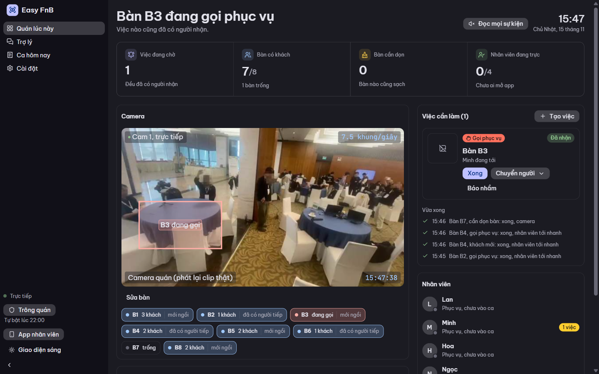
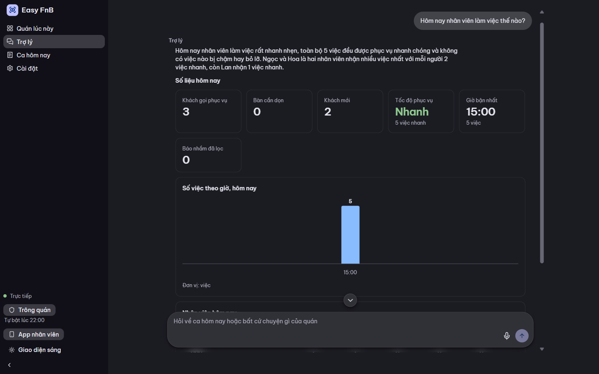
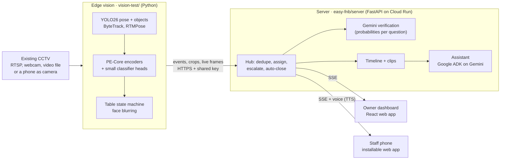
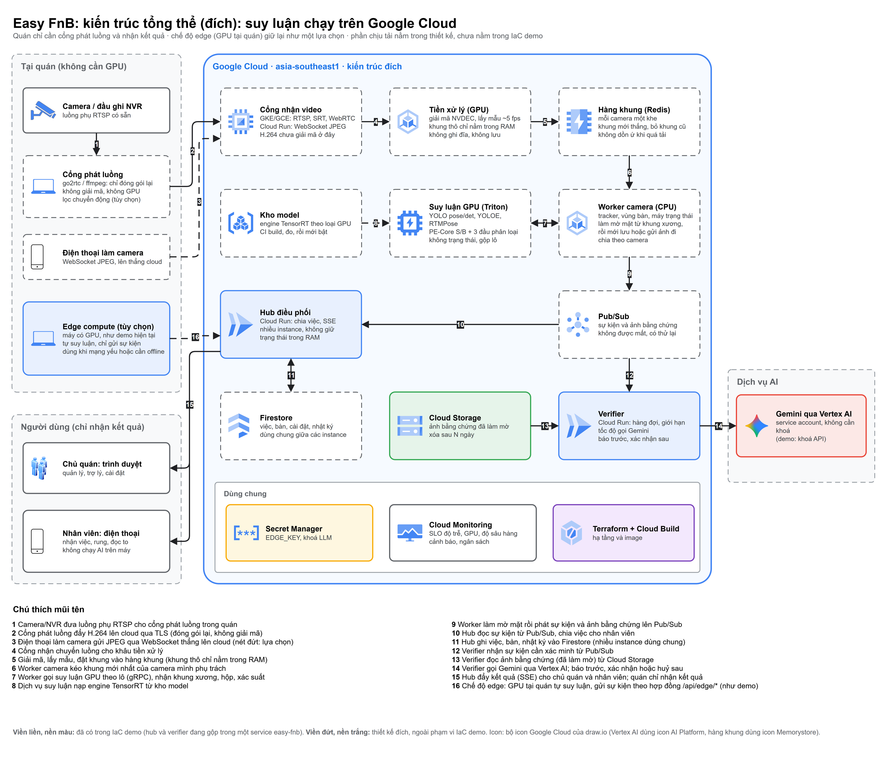

# Easy FnB

**An AI layer on top of the CCTV cameras a restaurant already has.** It notices a guest raising a hand, a table that needs clearing or a party that just sat down, sends the task to the right staff member's phone, and lets the owner ask an AI assistant what happened during the shift.

🏆 Second prize, Mini Hackathon, GDG DevFest MienTrung 2026 · [Tiếng Việt](README.vi.md)



*Live dashboard replaying team-recorded footage (faces blurred). Table B3 is calling; the task is already assigned.*

## The problem

In a busy café or restaurant, guests wave and nobody sees them. Staff are not lazy: one person has two eyes and the floor has a dozen tables. The owner only finds out when a review says so. Meanwhile, the ceiling cameras record everything and nobody watches them.

## What it does

| | |
|---|---|
| **Sees** | Hand-raise calls, new guests, guests leaving, tables that need clearing, guests looking around for staff, after-hours and restricted-zone alerts |
| **Dispatches** | Picks a staff member by role and workload, pushes the task to their phone and reads it aloud in Vietnamese through an earbud. No tapping needed: the task closes when the camera sees staff at the table |
| **Verifies** | Ambiguous events ("does this table need clearing, or did the guest just step out?") go to Gemini as a cropped image. It answers with probabilities and the task is only sent when the answer is confident |
| **Remembers** | Every event is stored on a timeline with a short video clip |
| **Answers** | The owner asks "How did the staff do today?" and gets numbers, charts and the matching video clips |



## How it works



The vision pipeline runs on a laptop at the venue (measured on an RTX 3050 with 4 GB of VRAM). The server holds the shift state, decides who gets which task and serves both web apps. A cloud-first design for many venues, with inference moved to GPUs in the cloud, is documented in [docs/architecture.md](docs/architecture.md).

## Measured results

All numbers come from the team's own test clips, run on a laptop RTX 3050 4 GB. Details and method: [vision-test/KET_QUA.md](vision-test/KET_QUA.md).

| Metric | Result |
|---|---|
| Table state (occupied, empty, needs clearing), strict scoring | 130 / 137 checkpoints |
| Table state, allowing 0.5 s of delay | 136 / 137 |
| Hand-raise calls caught | 5 / 7, with 0 false alarms |
| Hand-raise detection delay ("sensitive" mode) | 0.40 s on average |
| Full pipeline speed, "fast" mode | 57 fps (about 11 cameras at 5 fps each) |
| YOLO with TensorRT FP16 vs PyTorch | 2.4 to 2.8 times faster, same output |

Ten image encoders (CLIP, SigLIP 2, MobileCLIP2, DFN, PE-Core) were compared on the same data with a McNemar test before choosing one per task. The test set is small (7 hand raises, 137 table checkpoints), so these numbers show that the approach works on this footage, not how it would perform in every restaurant.

## Tech stack

| Layer | Technology |
|---|---|
| Vision | Python, PyTorch, Ultralytics YOLO26 (pose and objects), YOLOE, ByteTrack, RTMPose, Perception Encoder (PE-Core), TensorRT FP16, OpenVINO, OpenCV |
| Server | Python, FastAPI, Server-Sent Events, SQLite, in-memory dispatch hub, 280+ unit tests |
| AI services | Gemini API (image verification, shift summary), Gemini Decision, Google Agent Development Kit (assistant), Cloud Text-to-Speech |
| Web | React 19, TypeScript, Vite, Tailwind CSS 4, installable as a phone app (PWA) |
| Cloud | Cloud Run, Secret Manager, Artifact Registry, Cloud Storage, Cloud Build, Cloud Monitoring, all defined in Terraform |

## Repository layout

```
easy-fnb/        Web app (src/) and FastAPI server (server/)
  server/API.md  Contract between cameras, server and phones
vision-test/     Edge vision pipeline, evaluation scripts, experiments
infra/           Terraform for Google Cloud
docs/            Architecture, current-system description, 15 ADRs, research reports
```

## Quick start

The scripts target Windows. You need Python 3.12 and Node.js 20 or newer.

```
git clone https://github.com/dovuhoangtien/EasyFnB.git
cd EasyFnB\easy-fnb
chay_may_chu.bat
```

The first run creates a virtual environment, installs dependencies and builds the web app, then serves everything at `http://localhost:8080`. To see the product without a camera or a GPU, set `DEMO_LIVE=1` before starting: the server replays the bundled, face-blurred demo clips as if a camera were live.

Optional:

- **Gemini.** Copy `easy-fnb/.env.example` to `easy-fnb/.env` and add a key. Without one the app still runs; it skips image verification and the assistant answers from computed numbers.
- **Real camera pipeline.** Needs an NVIDIA GPU. One-time environment setup and the camera commands are in [easy-fnb/HUONG_DAN.md](easy-fnb/HUONG_DAN.md).
- **Tests.** In `easy-fnb`: `.venv\Scripts\python -m unittest discover -s server/tests -t . -v` (no network or key needed).
- **Deploy.** [infra/README.md](infra/README.md).

## Documentation

Most detailed documents are written in Vietnamese.

| Document | What it covers |
|---|---|
| [docs/he-thong-hien-tai.md](docs/he-thong-hien-tai.md) | The system as built: event flow, dispatch rules, Gemini decision rules, tests |
| [docs/architecture.md](docs/architecture.md) | Target architecture for many venues on Google Cloud |
| [docs/infra-design.md](docs/infra-design.md) | The demo infrastructure and what each service is used for |
| [docs/adr/](docs/adr/README.md) | 15 architecture decision records |
| [docs/research/](docs/research/) | Research reports behind the technology choices |
| [vision-test/KET_QUA.md](vision-test/KET_QUA.md) | Vision benchmarks |
| [vision-test/thu_nghiem/KET_LUAN.md](vision-test/thu_nghiem/KET_LUAN.md) | What was tried and what was kept |
| [easy-fnb/server/API.md](easy-fnb/server/API.md) | HTTP API |



## Privacy

By default, faces are blurred at the edge before any frame or crop leaves the venue. The demo footage in this repository was recorded by the team, with faces blurred. Third-party CCTV footage used for internal testing is not included.

## Status and limits

This is a hackathon prototype, not a finished product.

- Shift state lives in the memory of a single server instance.
- Accuracy was measured on a small set of clips, not in a real restaurant over time.
- The multi-venue cloud architecture is designed and documented but not implemented.
- Setup scripts are Windows-only.
