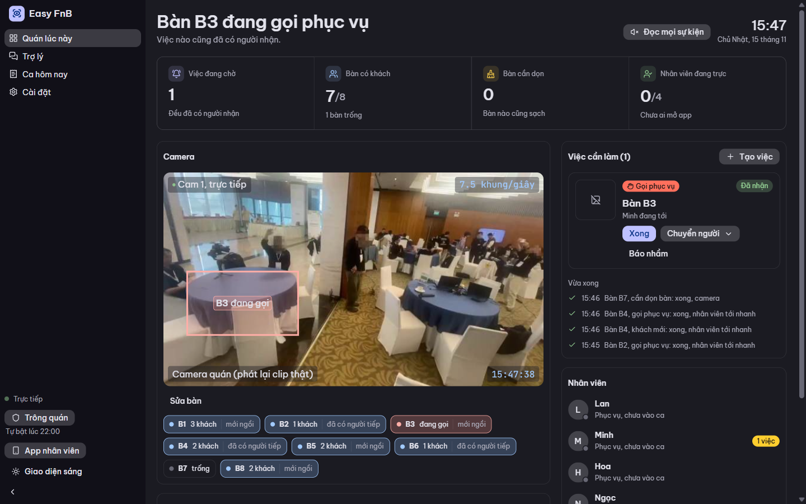
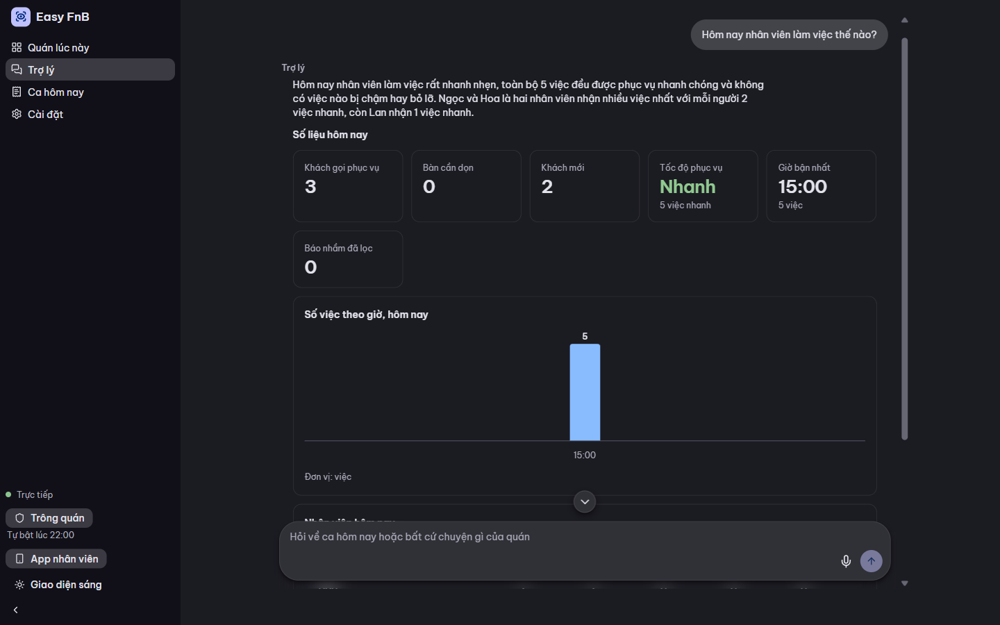
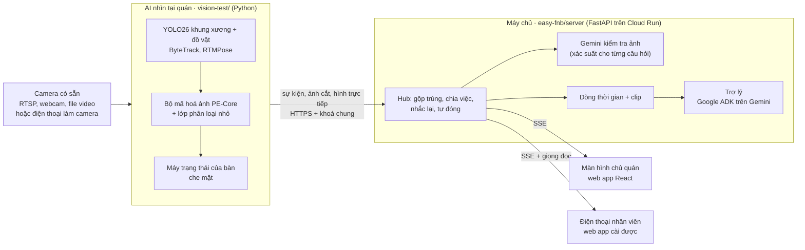
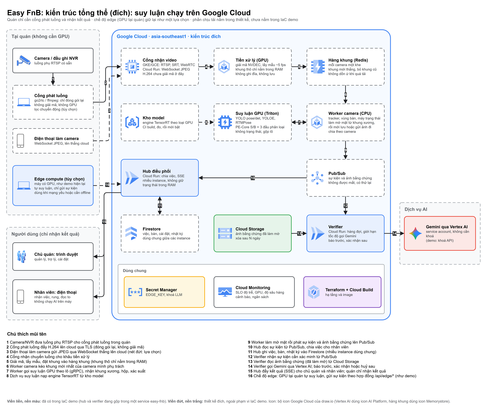

# Easy FnB

**Một lớp AI gắn lên chính những camera quán đã có.** Nó nhận ra khách giơ tay gọi, bàn cần dọn, khách vừa ngồi xuống, rồi giao việc vào điện thoại của đúng nhân viên. Chủ quán hỏi trợ lý AI là biết ca hôm nay diễn ra thế nào.

🏆 Giải nhì, Mini Hackathon, GDG DevFest MienTrung 2026 · [English](README.md)



*Màn hình trực tiếp đang phát lại clip nhóm tự quay (đã che mặt). Bàn B3 đang gọi, việc đã có người nhận.*

## Vấn đề

Ở quán đông, khách vẫy tay mà không ai thấy. Nhân viên không lười: một người chỉ có hai con mắt, còn quán có cả chục bàn. Chủ quán chỉ biết khi đọc được một bài chê trên mạng. Trong khi đó, camera trên trần quay cả ngày mà không ai xem.

## Sản phẩm làm gì

| | |
|---|---|
| **Nhìn** | Khách giơ tay gọi, khách mới, khách rời bàn, bàn cần dọn, khách nhìn quanh tìm nhân viên, cảnh báo ngoài giờ và vùng cấm |
| **Giao việc** | Chọn nhân viên theo vai trò và số việc đang làm, đẩy việc vào điện thoại và đọc to bằng tiếng Việt qua tai nghe. Không cần bấm: việc tự đóng khi camera thấy nhân viên tới bàn |
| **Kiểm tra** | Việc dễ nhầm ("bàn này cần dọn, hay khách chỉ ra ngoài một lát?") được gửi ảnh cắt lên Gemini. Model trả lời bằng xác suất, đủ chắc mới báo nhân viên |
| **Ghi nhớ** | Mọi sự kiện nằm trên dòng thời gian, kèm đoạn video ngắn |
| **Trả lời** | Chủ quán hỏi "Hôm nay nhân viên làm việc thế nào?" và nhận số liệu, biểu đồ, kèm đúng đoạn video |



## Cách hoạt động



Phần nhìn chạy trên một laptop đặt tại quán (đo trên RTX 3050, 4 GB VRAM). Máy chủ giữ trạng thái ca, quyết định ai nhận việc nào và phục vụ cả hai web app. Thiết kế cho nhiều quán, đưa phần suy luận lên GPU trên cloud, nằm ở [docs/architecture.md](docs/architecture.md).

## Số đo

Mọi số đều đo trên các clip test của nhóm, chạy trên laptop RTX 3050 4 GB. Chi tiết và cách chấm: [vision-test/KET_QUA.md](vision-test/KET_QUA.md).

| Chỉ số | Kết quả |
|---|---|
| Trạng thái bàn (có khách, trống, cần dọn), chấm chặt | 130 / 137 mốc |
| Trạng thái bàn, cho trễ 0,5 giây | 136 / 137 |
| Khách giơ tay: bắt được | 5 / 7, không báo nhầm lần nào |
| Khách giơ tay: độ trễ (bản "nhạy") | trung bình 0,40 giây |
| Tốc độ cả pipeline, bản "nhanh" | 57 khung/giây (khoảng 11 camera, mỗi camera 5 khung/giây) |
| YOLO chạy TensorRT FP16 so với PyTorch | nhanh hơn 2,4 đến 2,8 lần, kết quả y hệt |

Nhóm so 10 bộ mã hoá ảnh (CLIP, SigLIP 2, MobileCLIP2, DFN, PE-Core) trên cùng dữ liệu, có kiểm định McNemar, rồi mới chọn model cho từng việc. Bộ test còn nhỏ (7 lần giơ tay, 137 mốc bàn), nên các số này cho thấy cách làm chạy được trên những clip đó, chưa nói được nó sẽ ra sao ở mọi quán.

## Công nghệ

| Phần | Công nghệ |
|---|---|
| Nhìn | Python, PyTorch, Ultralytics YOLO26 (khung xương và đồ vật), YOLOE, ByteTrack, RTMPose, Perception Encoder (PE-Core), TensorRT FP16, OpenVINO, OpenCV |
| Máy chủ | Python, FastAPI, Server-Sent Events, SQLite, hub chia việc trong RAM, hơn 280 unit test |
| Dịch vụ AI | Gemini API (kiểm tra ảnh, tóm tắt ca), Gemini Decision, Google Agent Development Kit (trợ lý), Cloud Text-to-Speech |
| Web | React 19, TypeScript, Vite, Tailwind CSS 4, cài được lên điện thoại (PWA) |
| Cloud | Cloud Run, Secret Manager, Artifact Registry, Cloud Storage, Cloud Build, Cloud Monitoring, tất cả khai báo bằng Terraform |

## Cấu trúc repo

```
easy-fnb/        Web app (src/) và máy chủ FastAPI (server/)
  server/API.md  Hợp đồng giữa camera, máy chủ và điện thoại
vision-test/     Pipeline AI nhìn, bộ chấm điểm, các thử nghiệm
infra/           Terraform cho Google Cloud
docs/            Kiến trúc, mô tả hệ thống hiện tại, 15 ADR, báo cáo nghiên cứu
```

## Chạy thử

Các script viết cho Windows. Cần Python 3.12 và Node.js 20 trở lên.

```
git clone https://github.com/dovuhoangtien/EasyFnB.git
cd EasyFnB\easy-fnb
chay_may_chu.bat
```

Lần đầu script tự tạo môi trường, cài thư viện và build web, rồi chạy ở `http://localhost:8080`. Muốn xem sản phẩm mà không cần camera hay GPU thì đặt `DEMO_LIVE=1` trước khi chạy: máy chủ phát lại các clip demo đã che mặt như một camera đang chạy.

Tuỳ chọn:

- **Gemini.** Chép `easy-fnb/.env.example` thành `easy-fnb/.env` rồi điền khoá. Không có khoá app vẫn chạy, chỉ bỏ bước kiểm tra ảnh, và trợ lý trả lời từ số liệu tự tính.
- **Pipeline camera thật.** Cần GPU NVIDIA. Cách cài môi trường và lệnh chạy camera ở [easy-fnb/HUONG_DAN.md](easy-fnb/HUONG_DAN.md).
- **Test.** Trong `easy-fnb`: `.venv\Scripts\python -m unittest discover -s server/tests -t . -v` (không cần mạng hay khoá).
- **Deploy.** [infra/README.md](infra/README.md).

## Tài liệu

| Tài liệu | Nội dung |
|---|---|
| [docs/he-thong-hien-tai.md](docs/he-thong-hien-tai.md) | Hệ thống như đang chạy: luồng sự kiện, luật chia việc, luật quyết định của Gemini, test |
| [docs/architecture.md](docs/architecture.md) | Kiến trúc đích cho nhiều quán trên Google Cloud |
| [docs/infra-design.md](docs/infra-design.md) | Hạ tầng demo và từng dịch vụ dùng vào việc gì |
| [docs/adr/](docs/adr/README.md) | 15 bản ghi quyết định kiến trúc |
| [docs/research/](docs/research/) | Các báo cáo nghiên cứu đứng sau lựa chọn công nghệ |
| [vision-test/KET_QUA.md](vision-test/KET_QUA.md) | Số đo phần nhìn |
| [vision-test/thu_nghiem/KET_LUAN.md](vision-test/thu_nghiem/KET_LUAN.md) | Đã thử gì, giữ gì |
| [easy-fnb/server/API.md](easy-fnb/server/API.md) | HTTP API |



## Quyền riêng tư

Mặc định, khuôn mặt được che ngay tại quán trước khi bất kỳ khung hình hay ảnh cắt nào rời khỏi đó. Clip demo trong repo do nhóm tự quay và đã che mặt. Video CCTV của bên khác dùng để thử nội bộ không nằm trong repo.

## Hiện trạng và giới hạn

Đây là bản mẫu làm cho hackathon, chưa phải sản phẩm hoàn chỉnh.

- Trạng thái ca nằm trong RAM của một máy chủ duy nhất.
- Độ chính xác mới đo trên một số ít clip, chưa đo ở quán thật trong thời gian dài.
- Kiến trúc cloud cho nhiều quán đã thiết kế và viết tài liệu, chưa viết mã.
- Script cài đặt chỉ chạy trên Windows.
