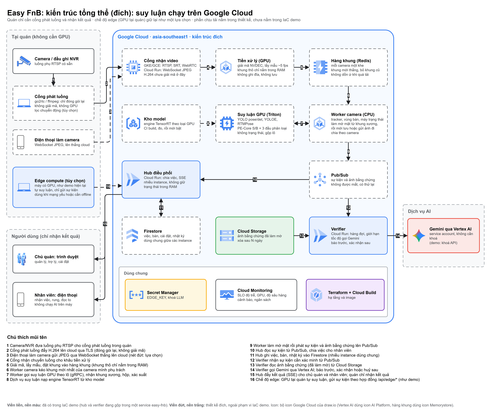

# Kiến trúc tổng thể (đích): suy luận chạy trên Google Cloud

Trạng thái: **bản nháp để duyệt**. Tài liệu này mô tả hệ thống cần hướng tới khi có nhiều quán và nhiều camera. Nó **không phải** những gì đang chạy hoặc đã có trong IaC. Phần demo hiện tại nằm ở [`infra-design.md`](infra-design.md) và `infra/`.

Sơ đồ: [`architecture/google-cloud-target.png`](architecture/google-cloud-target.png) (sửa được: [`.drawio`](architecture/google-cloud-target.drawio)).



## 1. Vì sao đổi hướng

Thiết kế demo đặt toàn bộ suy luận ở một laptop GPU tại quán (ADR-0002). Hướng đó đúng để dựng nhanh một demo, nhưng không phải hướng cho sản phẩm:

| Vấn đề | Chi tiết |
|---|---|
| **Tải tính toán** | Cấu hình demo (`vision-test/chay_camera.bat`) chạy khoảng **6 model nặng**: YOLO26n-pose, YOLO26s, YOLOE-26s-seg, RTMPose-m, PE-Core S/16, PE-Core B/16; thêm 3 đầu phân loại nhỏ (giơ tay, nhân viên, hành động) và một bộ bám ByteTrack. Chi phí mỗi khung **nhân theo số người trong cảnh** (RTMPose và PE-Core chạy trên từng người) nhân với số camera. |
| **Số đo hiện có** | Trên một RTX 3050 4 GB, clip stock, `KET_QUA.md`: bản nhanh ~57 khung/giây (35 ở clip đông nhất), bản nhạy ~24 (11 ở clip đông nhất). Quy ra khoảng **11 camera** ở bản nhanh, **~5 camera** ở bản nhạy, và chỉ **2** khi quán rất đông, mỗi camera 5 khung/giây. Đây là trần của một máy, không có dự phòng. |
| **Vận hành** | Mỗi quán một máy GPU: engine TensorRT gắn với đúng GPU đã build ra nó (`HUONG_DAN.md`), cập nhật model phải đến từng quán, máy hỏng là quán mất dịch vụ. |
| **Thực tế quán** | Quán thường không có máy GPU và không muốn mua thêm; báo cáo `Easy FnB không mua phần cứng.md` cũng đặt điều kiện "không mua phần cứng". |

Kết luận: **quán chỉ nên phát luồng và nhận kết quả**. Suy luận, điều phối và AI chạy trên cloud. Chế độ edge vẫn giữ như một lựa chọn (mục 6).

## 2. Các tầng

| Tầng | Làm gì | Có trạng thái? | Dịch vụ đề xuất |
|---|---|---|---|
| Cổng phát luồng (quán) | Lấy luồng phụ RTSP của NVR, đóng gói lại, đẩy lên cloud. Không giải mã, không GPU. Lọc chuyển động là tùy chọn | Không | go2rtc / ffmpeg trên máy luôn bật có sẵn |
| Cổng nhận video | Nhận H.264 (RTSP, SRT, WebRTC) hoặc JPEG qua WebSocket | Có (kết nối) | GCE/GKE cho RTSP/SRT/WebRTC; Cloud Run cho WebSocket JPEG |
| Tiền xử lý | Giải mã (NVDEC), lấy mẫu ~5 khung/giây | Không | GKE GPU |
| Hàng khung | Giữ **khung mới nhất** của mỗi camera, bỏ khung cũ | Có (ngắn hạn) | Memorystore (Redis) |
| Suy luận GPU | Chạy model nặng, trả khung xương, hộp, xác suất. Gộp lô giữa nhiều camera | **Không** | Triton trên GKE GPU, hoặc Cloud Run GPU |
| Worker camera | Tracker, vùng bàn, máy trạng thái, làm mờ mặt, tạo sự kiện | **Có, theo camera** | GKE/Cloud Run CPU, chia theo camera |
| Bus sự kiện | Chuyển sự kiện và ảnh bằng chứng, **không được mất** | Có (bền) | Pub/Sub |
| Hub điều phối | Chia việc, bộ đếm chuyển việc, SSE cho người dùng | Dựa vào Firestore | Cloud Run, nhiều instance |
| Verifier | Gọi Gemini có hàng đợi và giới hạn tốc độ | Không | Cloud Run |
| Lưu trữ | Việc, bàn, nhật ký; ảnh bằng chứng | Có | Firestore; Cloud Storage |

Hai điểm tách bạch quan trọng nhất:

- **Suy luận không trạng thái, logic camera có trạng thái** (ADR-0012). Suy luận có thể nhân bản, gộp lô, thay thế bất cứ lúc nào. Trạng thái (tracker, `rtm_cache` theo track id, cửa sổ nhân viên 10 giây, trạng thái bàn) gắn với một camera nên worker được chia theo camera. Worker chết thì dựng lại trạng thái trong im lặng vài giây; demo hiện có cơ chế tương tự khi video quay lại đầu clip (~4 giây, `HUONG_DAN.md`).
- **Hai loại luồng** (ADR-0013). Khung hình chịu được mất ("mới nhất thắng"), sự kiện thì không.

## 3. Mô hình tải

Nguồn tải, theo thứ tự thường nghẽn trước:

| # | Nguồn tải | Đơn vị nhân | Điểm nghẽn |
|---|---|---|---|
| 1 | Suy luận GPU | camera × khung/giây × người trong cảnh | Thời gian GPU. Chi phí lớn nhất |
| 2 | Băng thông lên của quán | camera × bitrate | Đường truyền quán |
| 3 | Giải mã video | camera × độ phân giải | NVDEC/CPU của cloud |
| 4 | Gọi Gemini (xác minh, trợ lý) | sự kiện cần xác minh | Quota và độ trễ API; ADK trả lời mất giây |
| 5 | Người dùng: SSE, dashboard, điện thoại | quán × (1 chủ + ~10 nhân viên) | Số kết nối giữ lâu trên hub, vòng lặp async đơn |
| 6 | Worker camera (CPU, RAM) | số camera | RAM trạng thái, chia lại khi chết |
| 7 | Giọng đọc | câu thoại mới | Câu lặp lại nhiều nên cache được |

### 3.1 Suy luận GPU

Từ `KET_QUA.md` (RTX 3050, trung bình theo clip, 5 khung/giây mỗi camera):

| Chế độ | ms/khung | Tải của 1 camera (GPU-giây mỗi giây, quy theo 3050) | Camera trên 1 GPU 3050 |
|---|---|---|---|
| Nhanh, trung bình | 17,5 | 0,088 | ~11 |
| Nhanh, clip đông nhất | 28,6 | 0,143 | ~7 |
| Nhạy, trung bình | 41,7 | 0,208 | ~5 |
| Nhạy, clip đông nhất | 90,9 | 0,455 | ~2 |

Công thức cỡ GPU cho một đội quán:

```
số GPU (quy 3050) = Σ_quán  camera × fps × ms_mỗi_khung/1000 × g / u
   g = tỉ lệ khung còn lại sau lọc chuyển động và bỏ qua camera vắng (chưa đo)
   u = mức dùng GPU mục tiêu (đề xuất 0,6 để còn chỗ cho giờ cao điểm)
số GPU thật = số trên / k      k = GPU cloud nhanh hơn 3050 bao nhiêu lần (CHƯA ĐO)
```

Ví dụ minh hoạ, **giả định** 8 camera mỗi quán, 5 khung/giây, g = 0,5, u = 0,6, chế độ nhanh trung bình:

| Số quán | GPU quy 3050 (k = 1, cận trên) |
|---|---|
| 10 | ~6 |
| 100 | ~58 |
| 1.000 | ~583 |

Chế độ nhạy trung bình nhân khoảng 2,4 lần. Chia cho k khi đã đo. k và g là hai con số quyết định nhất và **chưa có**, nên bước đầu tiên của lộ trình là đo chúng (mục 8).

**Cảnh báo về chi phí.** Báo cáo ước tính ~$3/quán/tháng khi 10 quán dùng chung một L4. Ước tính đó giả định một detector nano ~2 ms mỗi khung. Pipeline thật nặng gấp 7 đến 17 lần mỗi khung (17,5 đến 41,7 ms trên 3050). Với giá L4 báo cáo nêu ($0,672/giờ, Cloud Run, vùng Singapore **chưa xác nhận**) và 360 giờ mở cửa mỗi tháng, mỗi quán (8 camera, bản nhanh, g = 0,5) tốn khoảng **$141/k mỗi tháng**: $47 nếu k = 3, $28 nếu k = 5. Bản nhạy gấp ~2,4 lần. Con số báo cáo thấp hơn khoảng một bậc độ lớn. Đối chiếu: báo cáo ghi FlowLinks bán $35/camera/tháng, tức ~$280 cho 8 camera.

Gộp nhiều quán lên chung GPU giúp ít hơn tưởng: mọi quán ở Việt Nam cùng giờ cao điểm bữa trưa và bữa tối, nên mức dùng đỉnh chồng lên nhau (suy luận, chưa đo). Lợi ích chắc chắn là tắt GPU ngoài giờ mở cửa.

Cách giảm tải, theo mức tác động dự kiến (chưa đo cái nào):

1. Lọc chuyển động và bỏ qua camera vắng (giảm g).
2. Chỉ chạy model nặng khi có ứng viên: demo đã làm một phần (hỏi model giơ tay khi cổ tay trên vai, nhân viên mỗi 20 khung, đồ vật mỗi 100 khung, RTMPose theo lượt).
3. Gộp lô giữa nhiều camera trong Triton, thay vì mỗi camera một tiến trình riêng.
4. Giảm độ chính xác số (FP16 đã dùng; INT8) và hạ khung/giây khi quán vắng.
5. Edge lọc trước (chế độ lai, mục 6).

### 3.2 Băng thông và giải mã

Số dưới đây là **ước tính, chưa đo**. Clip mẫu không có trong bản checkout này nên không đo được kích thước JPEG thật.

| Cách gửi | Ước tính mỗi camera | 8 camera |
|---|---|---|
| JPEG 960 px, chất lượng 72 (cách demo đang dùng), 5 khung/giây, giả định 40 đến 100 KB mỗi khung | 1,6 đến 4 Mbps | 13 đến 32 Mbps |
| H.264 luồng phụ (độ phân giải thấp, đặt trên camera), giả định 0,3 đến 1 Mbps | 0,3 đến 1 Mbps | 2,4 đến 8 Mbps |

H.264 nén liên khung nên ít băng thông hơn JPEG từng khung. Vì vậy đường chính là H.264 (ADR-0011); JPEG qua WebSocket chỉ cho điện thoại-camera hoặc quán rất ít camera. Giải mã chuyển lên cloud (NVDEC hoặc CPU); số luồng giải mã được trên một GPU **chưa đo**.

### 3.3 Người dùng và LLM

- **Kết nối người dùng.** Mỗi quán ~12 kết nối SSE (1 chủ, ~10 nhân viên; giả định). 1.000 quán là ~12.000 kết nối giữ lâu. Một instance không đủ và không nên giữ trạng thái trong RAM: hub phải nhiều instance, trạng thái và phát tán qua Firestore hoặc Redis (ADR-0013). Hub hiện tại còn ghi file đồng bộ trong handler async (đã báo ở ADR-0003), phải sửa trước khi nhiều người dùng chung một vòng lặp.
- **Gemini.** Báo cáo giả định ~500 ứng viên mỗi camera mỗi ngày. Với 100 quán × 8 camera, đó là ~400.000 lượt xác minh mỗi ngày, trung bình ~4,6 lượt/giây, đỉnh có thể gấp nhiều lần. Phải có hàng đợi, giới hạn tốc độ theo quota của project, hạn chót và chế độ "báo chưa xác minh" khi quá hạn (demo đã có). Quota theo từng model nằm trong AI Studio / Vertex, **chưa kiểm**.
- **Trợ lý ADK.** Trả lời mất vài giây, không nằm trên đường báo việc; tách khỏi hub để không chặn vòng lặp.
- **Giọng đọc.** Tập câu hữu hạn ("Bàn B1 gọi phục vụ"), nên tạo sẵn và cache (báo cáo cũng đề xuất). Một bộ đọc chạy CPU trên server (VieNeu ~1 đến 1,5 giây mỗi câu mới, ~1,2 GB RAM) không mở rộng được.

## 4. Ngân sách độ trễ (mục tiêu, chưa đo)

Mục tiêu đề xuất: **từ lúc điều kiện báo đã đủ (ví dụ đã giữ tay đủ 0,6 giây) đến lúc điện thoại nhân viên nhận: p95 ≤ 1,5 giây**, khớp mục tiêu của báo cáo.

| Chặng | Ngân sách |
|---|---|
| Chờ khung kế tiếp (5 khung/giây) | ≤ 200 ms |
| Tải lên, nhận, giải mã | ≤ 250 ms |
| Hàng khung và chờ suy luận | ≤ 100 ms |
| Suy luận (gộp lô) | ≤ 150 ms |
| Worker (tracker, luật) | ≤ 50 ms |
| Pub/Sub, hub, SSE | ≤ 250 ms |
| Dự phòng | 500 ms |

Độ trễ mạng từ quán tới Singapore **chưa đo**; cần đo ở quán thật. Gemini nằm ngoài ngân sách này vì chạy bất đồng bộ.

## 5. Co giãn và suy giảm có kiểm soát

Khi quá tải, hệ thống hạ dần theo bậc thay vì dồn hàng (ADR-0015):

1. Bỏ khung cũ (đã là hành vi của "mới nhất thắng").
2. Hạ khung/giây cho camera vắng.
3. Bỏ RTMPose, dùng khung xương YOLO (bản "nhanh" thay bản "nhạy").
4. Ngừng xét hành động chi tiết, chỉ giữ "gọi phục vụ" và "bàn cần dọn".
5. Từ chối thêm camera mới và báo cho vận hành.

Co giãn GPU theo độ sâu hàng và mức dùng GPU. Chia công bằng giữa các quán để một quán đông không làm quán khác chậm. Worker camera chia theo camera bằng băm nhất quán.

## 6. Edge là một lựa chọn, không phải mặc định

Ba chế độ, cùng một hợp đồng sự kiện `/api/edge/*` (nên hub không cần biết sự kiện đến từ đâu):

| Chế độ | Mô tả | Dùng khi |
|---|---|---|
| **A. Chỉ cloud** (mặc định đích) | Quán chỉ có cổng phát luồng. Mọi suy luận trên cloud | Đa số quán; không muốn thiết bị |
| **B. Lai** | Máy nhỏ ở quán lọc chuyển động hoặc chạy detector nhỏ, chỉ gửi đoạn/khung có ứng viên | Đường lên yếu; muốn giảm GPU cloud (đòn bẩy giảm g) |
| **C. Edge đầy đủ** | Như demo: máy GPU ở quán suy luận, chỉ gửi sự kiện | Quán lớn có sẵn máy; cần chạy khi mất mạng; quán không cho video ra ngoài |

Chế độ C là đường chạy được **ngay hôm nay** và là con đường demo. Hai chế độ kia là việc cần xây.

## 7. Quyền riêng tư

Đưa suy luận lên cloud đổi tư thế dữ liệu: **video thô có mặt người rời quán** (ADR-0014). Ở demo, mặt bị làm mờ trước khi ảnh rời máy. Ở kiến trúc đích:

- Khung thô chỉ tồn tại **trong RAM** của tiền xử lý, hàng khung (TTL vài giây) và worker; không ghi đĩa, không ghi Cloud Storage.
- Làm mờ mặt phải ở worker, ngay khi có khung xương (mũi, mắt, tai từ YOLO-pose), **trước** khi lưu hay gửi bất kỳ ảnh nào (bằng chứng, xem trực tiếp, Gemini). Không thể làm ở khâu tiền xử lý vì chưa có khung xương.
- Đường truyền luôn TLS; hàng khung trong mạng riêng.
- Còn lại: đánh giá pháp lý (báo cáo nhắc Luật 91/2025 xếp khuôn mặt vào dữ liệu nhạy cảm), biển báo và đồng ý của quán, nơi xử lý dữ liệu (vùng). **Chưa có đánh giá nào.** Chế độ C là đường an toàn hơn cho quán không đồng ý đưa video ra ngoài.

## 8. Lộ trình và việc cần đo

| Pha | Nội dung | Trong IaC? |
|---|---|---|
| **P0 (demo)** | Hub + verifier trên Cloud Run một instance; edge GPU ở quán (chế độ C) | **Có** (`infra/`) |
| **P1 (một quán, lift and shift)** | Chạy các tiến trình `easyfnb_test.py` hiện có trên **một VM GPU** (L4) trong cloud, nguồn là luồng từ cổng nhận; ít sửa code nhất. Mục đích chính: đo k, g, băng thông, độ trễ | Không |
| **P2 (tách tầng)** | Tách suy luận (Triton) khỏi worker camera; hàng khung (Redis), Pub/Sub, Firestore; hub nhiều instance | Không |
| **P3 (sản phẩm)** | Đa thuê bao, xác thực chủ quán và nhân viên, CI cho model và engine TensorRT, SLO, cập nhật không gián đoạn | Không |

**Việc cần đo trước khi chốt (theo thứ tự):**

1. k: tốc độ pipeline trên L4 so với RTX 3050, ở bản nhanh và bản nhạy, với clip đông và vắng.
2. g: tỉ lệ khung còn lại sau lọc chuyển động trên footage thật của quán.
3. Băng thông và độ trễ từ quán thật tới `asia-southeast1`; bitrate H.264 luồng phụ thực tế.
4. Số luồng giải mã đồng thời trên một GPU; lợi ích gộp lô trong Triton.
5. Cloud Run GPU: có sẵn ở `asia-southeast1` không, giá và quota thật (báo cáo ghi chưa xác nhận giá vùng).
6. Quota Gemini theo project cho lượng xác minh dự kiến.
7. Mức chặn vòng lặp khi hub ghi ảnh qua gcsfuse (rủi ro đã nêu ở ADR-0003).

Việc P1 cần sửa trong code: nguồn video lấy từ cổng nhận thay vì file/RTSP cục bộ. Pipeline hiện là một tiến trình Python làm tất cả (giải mã, 6 model, tracker, tạo sự kiện), nên tách tầng (P2) là việc refactor thật, không phải đổi cấu hình.

## 9. Quyết định liên quan

ADR-0010 (suy luận lên cloud, edge tùy chọn, thay thế ADR-0002 cho kiến trúc đích), ADR-0011 (đường video vào cloud), ADR-0012 (tách suy luận khỏi worker), ADR-0013 (hai loại luồng, trạng thái ngoài RAM), ADR-0014 (quyền riêng tư), ADR-0015 (co giãn, suy giảm, SLO). Xem [`adr/README.md`](adr/README.md).
