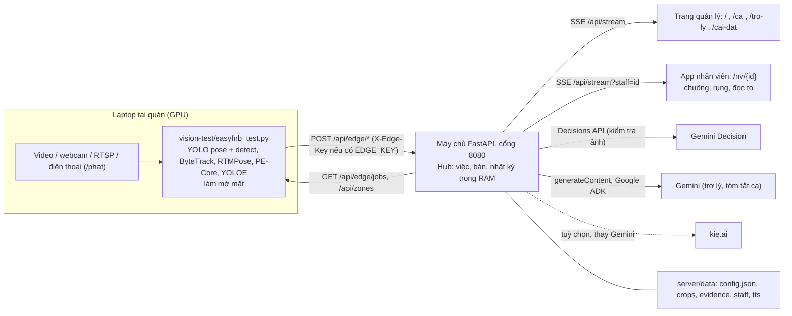

# Easy FnB: hệ thống đang chạy thế nào

Cập nhật: 13/11/2026, nhánh gemini-decision

Tài liệu này ghi lại hệ thống **như mã đang có trên đĩa** (kể cả phần chưa commit), không phải thiết kế đích. Chỗ nào chưa kiểm được trong mã thì ghi "chưa rõ". Thiết kế hạ tầng cloud nằm ở `docs/infra-design.md` và `docs/adr/`.

## 1. Tóm tắt

Easy FnB dùng camera để nhận ra khách giơ tay gọi, bàn cần dọn và khách mới vào bàn, rồi giao việc cho nhân viên qua điện thoại. Bản demo chạy theo kiểu "edge": AI camera chạy trên laptop có GPU (`vision-test`), chỉ gửi sự kiện, ảnh cắt đã làm mờ mặt, khung hình trực tiếp và trạng thái bàn lên máy chủ (`easy-fnb/server`, cổng 8080). Cùng máy chủ đó phục vụ trang quản lý của chủ quán và app web của nhân viên, chia việc, và gọi Gemini để kiểm tra ảnh "cần dọn", trả lời câu hỏi về ca và viết tóm tắt ca. Mọi việc, bàn và nhật ký của ca nằm trong bộ nhớ của một tiến trình máy chủ.



## 2. Các phần và thư mục

| Phần | Nằm ở đâu | Làm gì |
|---|---|---|
| Camera AI | `vision-test/easyfnb_test.py` | Đọc video hoặc camera, bám từng người, theo dõi từng bàn, sinh sự kiện |
| Gửi lên máy chủ | `vision-test/gui_may_chu.py` | Luồng nền gửi sự kiện, gói ảnh xác minh, khung hình, trạng thái bàn; lấy vùng bàn và việc thiết lập từ máy chủ |
| Phần phụ của camera | `vision-test/nhin_quanh.py`, `hanh_dong.py`, `thiet_lap.py`, `clip_cls.py`, `fnb_common.py` | Khách nhìn quanh; tỉ lệ hành động; tìm bàn và chụp ảnh nhân viên; phân loại ảnh bằng CLIP/PE-Core; cắt ảnh, làm mờ mặt |
| Tệp chạy camera | `vision-test/chay_camera.bat`, `chay_camera_dien_thoai.bat`, `chay_video_mau.bat`, `xuat_engine.py`, `nap_vung_ban.py` | Chạy bản demo, đọc luồng từ điện thoại, chạy clip mẫu, xuất engine TensorRT, nạp vùng bàn mẫu |
| Máy chủ | `easy-fnb/server/app.py` | Các đường API, phục vụ web đã build (`easy-fnb/dist`) |
| Điều phối | `easy-fnb/server/hub.py` | Trạng thái cả hệ thống, luật gộp trùng, giao việc, xác minh, tự đóng, báo cáo ca |
| Gemini | `easy-fnb/server/gemini.py` | Kiểm tra ảnh (generateContent hoặc Decisions API), trả lời, tóm tắt, luật quyết định |
| kie.ai | `easy-fnb/server/llm.py` | Nhà cung cấp LLM thay thế, cùng giao diện với `Gemini` |
| Trợ lý | `easy-fnb/server/tro_ly.py` | Tác tử Google ADK trên Gemini, hoặc trả lời theo từ khoá không dùng AI |
| Gợi ý ca sau | `easy-fnb/server/goi_y.py` | Gợi ý và bảng xếp ca, tính từ số liệu, không gọi AI |
| Giọng đọc | `easy-fnb/server/tts.py`, `tts_worker*.py`, `server/voices/` | Đọc tiếng Việt thành wav (VieNeu, dự phòng Piper) |
| HTTPS trong LAN | `easy-fnb/server/tls.py`, `proxy.py`, `net.py` | Chứng chỉ tự ký và cổng https chuyển tiếp vào cổng http |
| Hợp đồng API | `easy-fnb/server/API.md` | Kiểu dữ liệu và các đường API |
| Test máy chủ | `easy-fnb/server/tests/` | 7 tệp `unittest` |
| Web | `easy-fnb/src/` | React 19 + Vite; `app/` là các màn hình, `live/` là kho dữ liệu SSE, API, kiểu, giọng đọc; `pages/live/PhoneCamera.tsx` là trang `/phat` |
| Mô phỏng cũ | `easy-fnb/src/sim/` | Bộ mô phỏng; `App.tsx` không gắn đường dẫn nào trỏ thẳng vào đây. Còn được dùng ở đâu: chưa rõ |
| Hướng dẫn chạy | `easy-fnb/HUONG_DAN.md`, `easy-fnb/.env.example`, `chay_may_chu.bat`, `mo_https_lan.bat`, `mo_https_cho_dien_thoai.bat` | Cách chạy trên máy, tên biến môi trường |
| Hạ tầng cloud | `infra/`, `docs/infra-design.md`, `docs/adr/`, `easy-fnb/Dockerfile` | Terraform, thiết kế, 9 ADR, ảnh Docker |
| Âm thanh mẫu | `am_thanh/` (chưa vào git) | Các tệp wav/mp3 nghe thử giọng đọc |

## 3. Luồng một sự kiện từ camera tới nhân viên

### Camera gửi gì

| Camera gửi (`kind`) | Máy chủ hiểu là | Kết quả |
|---|---|---|
| `goi_phuc_vu` | `call` | Tạo việc, ưu tiên vai trò `serve` |
| `can_don` | `needs_clearing` | Tạo việc, ưu tiên vai trò `clean` |
| `khach_moi` | `new_guest` | Tạo việc, ưu tiên vai trò `serve` |
| `khach_roi` | `guest_left` | Chỉ ghi nhật ký |
| `da_don` | `cleared` | Ghi nhật ký, đóng việc "cần dọn" đang mở của bàn đó |
| `nv_den` | `staff_arrived` | Ghi lúc nhân viên có mặt ở bàn (xem "Tự đóng") |
| `nhin_quanh` | `looking` | Tín hiệu mềm: nhắc trên trang quản lý, không tạo việc, không đọc cho nhân viên |

Sự kiện `goi_phuc_vu` và `can_don` gửi ngay kèm một ảnh cắt và một mã `eid`. Khoảng 1 giây sau camera gửi thêm gói ảnh xác minh (`POST /api/edge/evidence`, cùng `eid`): dải 2x2 bốn khung quanh sự kiện, ảnh toàn cảnh có khung đỏ, và với "cần dọn" thêm ảnh bàn lúc sạch.

### Trạng thái của một việc (`Alert.status`)

| Trạng thái | Nghĩa |
|---|---|
| `verifying` | Đang giữ, chờ AI kiểm tra xong mới báo nhân viên (chỉ loại nằm trong `hold_until_verified`) |
| `open` | Đã báo, chưa ai nhận |
| `acked` | Nhân viên bấm "Tôi đang tới", hoặc camera thấy nhân viên tới dọn bàn |
| `done` | Xong (nhân viên, quản lý hoặc camera đóng) |
| `cancelled` | Báo nhầm (AI bác, hoặc quản lý/nhân viên huỷ) |

Kết quả xác minh (`verify.state`): `skipped` (không kiểm tra), `pending`, `confirmed`, `rejected`, `unverified`. `API.md` còn ghi `error` trong kiểu `VerifyState`, nhưng mã hiện dùng `unverified` kèm `verify.path` (`timeout`, `error`, `breaker_open`, `no_image`, `poor_image`, `uncertain`, `inconsistent`, `belongings`).

### Các bước trong `Hub.edge_event`

1. **Gộp trùng (`_dedup`).** Sự kiện cùng loại, cùng bàn được gộp vào việc cũ nếu việc đó còn mở, hoặc mới tạo trong `dedup_s` giây (mặc định 20). Bàn đã biết thì gộp cả khi hai camera cùng thấy. Không có bàn thì chỉ gộp trong cùng camera, khi tâm khung người lệch dưới 150 px. Việc cũ tăng `repeats` và được ghi là "khách vẫn đang gọi" (lùi giờ tự đóng).
2. **Tạo việc.** Mã `a1`, `a2`... Ảnh cắt lưu vào `server/data/crops/`.
3. **Có kiểm tra không.** Kiểm tra khi có khoá LLM, loại việc nằm trong `verify_kinds`, và có ảnh hoặc `eid`. Nếu loại việc còn nằm trong `hold_until_verified` thì việc ở `verifying` và chưa giao cho ai.
4. **Giao việc (`_assign`).** Người đúng vai trò chính trước (`call`, `new_guest`: `serve` rồi `clean`; `needs_clearing`: `clean` rồi `serve`); vai trò phụ bị cộng 3 điểm nên chỉ nhận khi người chính đang gánh nhiều hơn 3 việc. Ưu tiên người đang mở app; ít việc đang mở nhất; hoà thì người được giao lâu nhất. Vai trò `cashier` không nhận việc nào.
5. **Phát cho các màn hình** qua SSE (`alert`, `staff`, `log`).

### Xác minh (`_verify_inner`)

- Chờ gói ảnh tối đa `evidence_wait_s` (2,5 giây) kể từ lúc báo; không tới thì dùng ảnh cắt lúc báo; không có ảnh nào thì "chưa xác minh" (`no_image`).
- Gọi LLM với hạn `VERIFY_TIMEOUT_S` = 2,5 giây (100 giây khi chạy kie.ai).
- Bộ ngắt mạch: 3 lần lỗi hoặc quá hạn liên tiếp thì ngừng gọi 60 giây, sau đó cho thử một lần.
- **Xác nhận:** việc đang giữ chuyển sang `open` và được giao. **Bác:** việc đang `verifying` hoặc `open` bị huỷ (người huỷ ghi là Gemini); việc đã có người nhận thì chỉ ghi nhật ký, không huỷ. **Chưa xác minh** (không chắc, ảnh kém, quá hạn, lỗi, ngắt mạch): việc vẫn được báo cho nhân viên, gắn nhãn "Chưa xác minh". Lỗi hay quá hạn không bao giờ chặn một cảnh báo.

### Nhân viên, quản lý và camera đóng việc

| Việc gì xảy ra | Kết quả |
|---|---|
| Nhân viên bấm "Tôi đang tới" (`/ack`) | `acked`, ghi số giây từ lúc báo |
| Bấm "Xong" (`/done`) | `done` |
| "Báo nhầm" (`/cancel`) | `cancelled` kèm lý do |
| Quản lý giao lại (`/assign`), tạo việc tay (`POST /api/alerts`) | Việc tạo tay không qua AI |
| Camera gửi `nv_den` | Việc `call` và `new_guest` của bàn đó đóng luôn (`done`, người đóng là camera), lấy lúc đó làm thời gian phản hồi (`arrived_s`). Việc `needs_clearing` chỉ chuyển `acked` ("đang dọn") |
| Camera gửi `da_don` | Đóng việc `needs_clearing` của bàn |
| Không ai nhận sau `auto_close_s` (90 giây) | Việc `call`, `new_guest` tự đóng với lý do "không thấy nhân viên tới, khách đã thôi gọi"; báo cáo ca đếm là bỏ lỡ. Tính từ lần cuối camera còn thấy khách gọi. "Cần dọn" không tự đóng theo giờ |
| Không ai nhận sau `escalate_s` | Chuyển người khác, tối đa 2 lần, gắn nhãn "Gấp". Mặc định trong mã là 0, tức tắt |
| Nhân viên rớt kết nối | Chờ 15 giây (`OFFLINE_GRACE_S`); vẫn không nối lại thì tính ra ca, việc đang mở chuyển cho người khác đang online nếu có |

Vòng lặp nền (`tick`) chạy mỗi giây: xử lý ra ca, camera mất hình (5 giây không có khung), giao việc chưa có người, tự đóng, chuyển người.

## 4. Camera và AI tại quán

Lệnh demo (`chay_camera.bat`) bật các model sau; tên tệp lấy từ chính lệnh đó:

| Việc | Model / cách làm |
|---|---|
| Tìm và bám người | `yolo26n-pose` (engine TensorRT 544x960 FP16) + ByteTrack |
| Khung xương kỹ hơn | RTMPose-m, chế độ `luot` (mỗi khung vài người) |
| Đồ vật, bàn | `yolo26s` (engine TensorRT 736x1280), chạy mỗi 100 khung |
| Giơ tay gọi | Luật khung xương kết hợp model nhỏ `giotay_pe_b16.pt` (ngưỡng 0,35), thêm đường "tích luỹ" khi model hơi tin nhưng kéo dài |
| Nhân viên hay khách | `nhanvien_pe_b16.pt`, xét mỗi 20 khung |
| Bàn sạch hay bẩn | CLIP không train, bộ mã hoá `pe_core_s16` |
| Đồ còn trên bàn sau khi khách rời | YOLOE (`--yoloe`), tên đồ gửi kèm sự kiện "cần dọn" |
| Tỉ lệ hành động từng người | PE-Core so ảnh với câu mô tả (`--hanh-dong`); dùng để kiểm tra chéo: "giơ tay gọi" dưới 25% thì không báo gọi |

Một số luật đáng biết (theo `HUONG_DAN.md` và tham số mặc định): người đứng không tính là khách gọi; hai tay cùng giơ quá đầu coi là vươn vai; giơ tay liên tục 0,6 giây mới báo (`--hand-s`); đổi trạng thái bàn cần 1 giây xác nhận (`--confirm`). Mặt khách được làm mờ trước khi ảnh rời máy camera (tắt bằng `--khong-mo-mat`, chỉ để soát lỗi).

**Khách nhìn quanh** (`nhin_quanh.py`): chỉ chạy khi thêm cờ `--nhin-quanh`; `chay_camera.bat` hiện không bật cờ này. Ngưỡng đặt theo suy luận hình học, tệp ghi rõ chưa chỉnh trên clip quán thật.

**Vùng bàn.** Mỗi bàn là một đa giác trên ảnh của một camera, lưu theo mã camera (`cam1`, `cam2`...). Vẽ ở trang Cài đặt, mục Vùng bàn; camera hỏi lại máy chủ vài giây một lần nên áp dụng mà không phải chạy lại, và giữ bản sao ở `vision-test/vung_ban_may_chu.json` để đẩy lên lại khi máy chủ khởi động lại. Clip mẫu có vùng sẵn trong `vision-test/zones.json`.

**Thiết lập quán** (`thiet_lap.py`, máy camera hỏi `GET /api/edge/jobs` mỗi giây):

- `find_tables`: tìm bàn bằng lớp "dining table" của model đồ vật; có khoanh thô một vùng thì trả đúng một bàn.
- `staff_photo`: cắt người đứng gần giữa khung hình nhất làm ảnh nhận dạng nhân viên.
- Nhận nhân viên theo ảnh chụp sẵn chỉ chạy với cờ `--nv-theo-anh` (không có trong `chay_camera.bat`); hai mốc điểm giống ảnh được ghi là chưa đo trên clip thật. Chỉ ảnh của người đã bật "Cho camera nhận dạng" mới được gửi cho máy camera.

Số đo của pipeline (bàn, giơ tay, tốc độ) nằm ở `vision-test/KET_QUA.md`, đo trên clip thử ngày 5/11/2026, không nhắc lại ở đây.

## 5. Máy chủ

### Nhóm API (chi tiết ở `easy-fnb/server/API.md`)

| Nhóm | Đường chính | Ghi chú |
|---|---|---|
| Đọc | `GET /api/state`, `/api/stream` (SSE), `/api/info`, `/api/health`, `/api/camera/{cam}/frame.jpg`, `/snapshot.jpg`, `/api/crops/{id}.jpg`, `/api/alerts/{id}/evidence/{vai trò}.jpg` | SSE gửi `snapshot` trước, rồi `alert`, `table`, `camera`, `zones`, `staff`, `log`, `settings`, `reset`; `?staff=<id>` đánh dấu nhân viên đang trong ca |
| Thao tác việc | `POST /api/alerts/{id}/ack`, `/done`, `/cancel`, `/assign`, `POST /api/alerts` | |
| Thiết lập | `GET/PUT /api/zones`, `POST /api/zones/suggest`, `GET/PUT /api/staff`, ảnh nhân viên `/api/staff/{id}/photos...`, `PUT /api/settings`, `POST /api/reset` | `reset` xoá việc, nhật ký, bàn, ảnh cắt; giữ vùng bàn, nhân viên, cài đặt |
| AI và báo cáo | `POST /api/assistant`, `GET /api/report`, `GET /api/insights`, `POST /api/report/summary`, `POST /api/ai/test` | `report` và `insights` không gọi AI |
| Camera gửi lên | `POST /api/edge/event`, `/evidence`, `/frame`, `/tables`; `GET /api/edge/jobs`, `POST /api/edge/jobs/{id}`, `GET /api/edge/staff-refs` | Kiểm tra `X-Edge-Key` khi máy chủ có `EDGE_KEY` |
| Điện thoại làm camera | `POST /api/phone/{cam}/frame`, WebSocket `/api/phone/{cam}/ws`, `GET /api/phone/{cam}/mjpeg`, `/status` | Pipeline đọc `/mjpeg` như camera IP |
| Giọng đọc | `GET /api/tts?text=...`, `/api/tts/status` | 404 khi máy chủ không có bộ đọc |
| Manifest app nhân viên | `GET /api/manifest/nv/{id}` | Vừa gộp, xem mục 7 |
| Web | Mọi đường khác trả tệp trong `dist` hoặc `index.html` | |

Ngoài `/api/edge/*`, không đường nào kiểm tra danh tính người gọi; CORS mở cho mọi nguồn.

### Cài đặt và giá trị mặc định

| Cài đặt | Mặc định trong `hub.py` | Nghĩa |
|---|---|---|
| `verify_kinds` | `['call', 'needs_clearing']` | Loại việc gửi AI kiểm tra |
| `hold_until_verified` | `['needs_clearing']` | Loại việc giữ lại tới khi kiểm tra xong |
| `escalate_s` | 0 (tắt) | Chưa ai nhận thì chuyển người sau chừng này giây |
| `dedup_s` | 20 | Cửa sổ gộp sự kiện trùng |
| `evidence_wait_s` | 2,5 | Chờ gói ảnh xác minh |
| `auto_close_s` | 90 | Tự đóng việc gọi / khách mới không ai nhận |

`app.py` đổi mặc định theo nhà cung cấp LLM lúc khởi động:

| Đang chạy | `verify_kinds` | `hold_until_verified` |
|---|---|---|
| kie.ai (`KIE_API_KEY`) | rỗng | rỗng (hạn xác minh 100 giây nếu bật lại) |
| Gemini Decision (`GEMINI_VERIFY_MODEL` bắt đầu bằng `gemini-decision`) | `['needs_clearing']` | `['needs_clearing']` |
| Gemini thường | như bảng trên | như bảng trên |

Giá trị đã lưu trong `server/data/config.json` thắng các mặc định này. Tệp trên máy hiện lưu `verify_kinds` và `hold_until_verified` đều là `['needs_clearing']`, `escalate_s` 0, `auto_close_s` 90. Trang Cài đặt, mục Kết nối có công tắc cho: AI kiểm tra "khách gọi", AI kiểm tra "cần dọn bàn", chờ AI xác nhận rồi mới báo dọn bàn, giây nhắc lại, giây tự đóng.

Lưu ý lệch tài liệu: `API.md` ghi `escalate_s` mặc định 45 và `PUT /api/settings` chỉ nhận 4 khoá; mã nhận 6 khoá và mặc định `escalate_s` là 0.

### Dữ liệu lưu ở đâu

| Dữ liệu | Nơi lưu | Còn sau khi khởi động lại? |
|---|---|---|
| Việc, trạng thái bàn, nhật ký (500 dòng gần nhất), điểm danh, camera, khung hình | RAM của tiến trình máy chủ | Không |
| Cài đặt, nhân viên, vùng bàn | `DATA_DIR/config.json` (mặc định `server/data`) | Có |
| Ảnh cắt, gói ảnh xác minh | `DATA_DIR/crops`, `DATA_DIR/evidence` | Tệp còn, nhưng việc tương ứng đã mất; `reset` xoá |
| Ảnh nhận dạng nhân viên | `DATA_DIR/staff` | Có |
| Wav giọng đọc | `DATA_DIR/tts` | Có |
| Phiên trò chuyện của trợ lý ADK | RAM (theo `docs/infra-design.md`) | Không |

Không có cơ sở dữ liệu.

## 6. Gemini

### Dùng cho việc gì

| Việc | Model | Đường gọi |
|---|---|---|
| Trợ lý hỏi đáp (`/api/assistant`) | `GEMINI_MODEL` | Google ADK: Gemini chọn công cụ, máy chủ điền số và khối hiển thị. ADK lỗi hoặc quá 30 giây thì trả lời theo từ khoá (`engine: 'rules'`) |
| Tóm tắt ca (`/api/report/summary`) | `GEMINI_MODEL` | `generateContent`; không có khoá thì trả bản mẫu tự động |
| Kiểm tra ảnh | `GEMINI_VERIFY_MODEL` nếu là `gemini-decision-*`, không thì `GEMINI_MODEL` | Decisions API (`/v1beta/decisions`), hoặc `generateContent` với schema JSON |
| Khách nhìn quanh | Gemini Decision | Chỉ hỏi khi camera chấm dưới 0,9 và có ảnh cắt; chỉ bỏ khi Gemini khá chắc là không phải |

### Biến môi trường (chỉ tên)

| Biến | Nghĩa |
|---|---|
| `GEMINI_API_KEY` | Khoá Gemini. Không có thì không kiểm tra ảnh, trợ lý trả lời theo luật |
| `GEMINI_MODEL` | Mặc định `gemini-3.5-flash-lite` |
| `GEMINI_VERIFY_MODEL` | Đặt `gemini-decision-1` để kiểm tra ảnh bằng Gemini Decision |
| `KIE_API_KEY`, `KIE_MODEL`, `KIE_EFFORT` | Có `KIE_API_KEY` thì kiểm tra ảnh và tóm tắt đi qua kie.ai (mặc định `deepseek-v4-1-flash`); trợ lý ADK vẫn dùng khoá Gemini |
| `EDGE_KEY` | Khoá chung giữa camera và máy chủ |
| `DATA_DIR`, `PORT` | Thư mục dữ liệu, cổng |
| `TTS_ENGINE`, `VIENEU_VOICE`, `VIENEU_PYTHON`, `PIPER_PYTHON`, `PIPER_MODEL` | Giọng đọc |

Máy chủ tự đọc `easy-fnb/.env` khi khởi động; biến đã đặt sẵn trong môi trường thắng tệp này.

### Hiện trạng với Gemini Decision

- **"Cần dọn"** được kiểm tra và giữ lại tới khi có kết quả.
- **"Gọi phục vụ"** báo nhân viên ngay, không hỏi lại Gemini. Lý do ghi trong `app.py`: hỏi mất khoảng 1 giây mà chỉ xác nhận được một nửa số lần gọi thật. Bật lại bằng công tắc trong Cài đặt.

### Luật quyết định theo xác suất (`_decide_probs`)

Mỗi câu hỏi trả về xác suất "có". Ngưỡng: `P_YES` 0,7; `P_NO` 0,3; `P_NO_HAND` 0,2; `P_CALL` 0,6. Trước hết, "ảnh đủ rõ" dưới 0,5 thì chưa xác minh.

**Gọi phục vụ**, hỏi 4 câu: `hand_above_head` (giơ tay cao để gây chú ý), `arm_raised_high` (duỗi tay, bàn tay cao hơn đỉnh đầu), `wearing_staff_uniform`, `image_clear`. Hai câu về tay bổ sung cho nhau: tay bị che thì câu đầu thấp, câu sau vẫn cao; vuốt tóc thì ngược lại.

| Thứ tự xét | Điều kiện | Kết quả |
|---|---|---|
| 1 | Là nhân viên ≥ 0,7 | Bác |
| 2 | Cả hai câu về tay ≤ 0,2 | Bác |
| 3 | Là nhân viên ≥ 0,5 | Chưa xác minh |
| 4 | `hand_above_head` < 0,5, hoặc trung bình hai câu về tay < 0,6 | Chưa xác minh |
| 5 | Còn lại | Xác nhận |

**Cần dọn**, hỏi 4 câu: `used_items_left`, `people_at_table`, `personal_belongings_present`, `image_clear`.

| Thứ tự xét | Điều kiện | Kết quả |
|---|---|---|
| 1 | Còn người ngồi > 0,3 | Chưa xác minh |
| 2 | Còn đồ đã dùng ≤ 0,3 | Bác (bàn sạch) |
| 3 | Còn đồ đã dùng < 0,7 | Chưa xác minh |
| 4 | Còn đồ cá nhân ≥ 0,5 | Chưa xác minh (khách có thể ra ngoài tạm) |
| 5 | Còn lại | Xác nhận |

Đường `generateContent` (Gemini thường, kie.ai) dùng luật `decide()` theo verdict và checklist, cùng tinh thần: chỉ bác khi khá chắc là nhầm.

### Số đo thật

Đo ngày 13/11/2026 trên 9 mẫu có nhãn quay trong lớp học:

- Gemini Decision mất khoảng 0,5 đến 1,5 giây mỗi lần kiểm tra, gọi từ laptop.
- Xác nhận được 3 trên 6 lần gọi thật; không bác nhầm lần gọi thật nào. Ba lần còn lại ra "chưa xác minh" (vẫn báo nhân viên).
- Trong 3 mẫu không phải gọi: bác 1, hai mẫu còn lại (một người vuốt tóc) ra "chưa xác minh".
- Các ngưỡng ở trên chỉ được chỉnh trên đúng 9 mẫu này.

Mã chỉ ghi lại một phần các số này trong chú thích (`gemini.py`, `app.py`); không thấy tệp kết quả đo trong repo. Câu hỏi cho "khách nhìn quanh" được ghi rõ là chưa thử với Gemini thật.

## 7. Giao diện

| Màn hình | Đường dẫn | Làm gì |
|---|---|---|
| Khung chủ quán (`OwnerShell`) | thanh trên cùng | Ba mục, nút "App nhân viên" (link và mã QR từng người), nút Cài đặt, chấm "Trực tiếp" |
| Bây giờ (`Now`) | `/` | Hình camera trực tiếp, trạng thái từng bàn, bốn con số (việc đang chờ, bàn có khách, bàn cần dọn, nhân viên đang trực), hàng việc với nút Xong / Báo nhầm / giao lại, tạo việc tay, thước tốc độ phục vụ, công tắc "Đọc mọi sự kiện" |
| Ca hôm nay (`Shift`) | `/ca` | Số liệu ca, biểu đồ việc theo giờ và theo bàn, tốc độ phục vụ, từng nhân viên, gợi ý cho ca sau (`/api/insights`), nút viết tóm tắt ca |
| Trợ lý (`Assistant`) | `/tro-ly` | Hỏi đáp về ca; câu trả lời kèm khối chỉ số, biểu đồ, sự kiện có ảnh, bảng, thẻ nhân viên; có câu hỏi gợi ý và hỏi bằng lời |
| Cài đặt (`Settings`) | `/cai-dat` | Ba thẻ: Vùng bàn (vẽ đa giác, nhờ camera tự tìm bàn), Nhân viên (tên, vai trò, ảnh nhận dạng, đồng ý nhận dạng), Kết nối (camera, lệnh chạy camera, mã QR điện thoại làm camera, thử kết nối AI, quy tắc báo việc, bắt đầu ca mới) |
| App nhân viên (`StaffPhone`) | `/nv`, `/nv/{id}` | Chọn tên; bấm "Bắt đầu ca" để mở âm thanh; danh sách việc của mình với "Tôi đang tới" và "Xong"; giữ màn hình sáng nếu trình duyệt cho |
| Điện thoại làm camera (`PhoneCamera`) | `/phat?cam=cam1` | Gửi khung JPEG qua WebSocket; cần https |

Tốc độ phục vụ hiện bằng chữ (nhanh, hơi chậm, chậm) thay cho số giây; mốc 30 và 60 giây đặt ở `hub.py` (`FAST_S`, `SLOW_S`).

### Giọng đọc và âm thanh

- App nhân viên kêu chuông (WebAudio), rung và đọc to việc mới. Trình duyệt chặn âm thanh tự phát nên phải bấm "Bắt đầu ca" mỗi lần mở.
- Nếu máy chủ có bộ đọc (`/api/tts/status`) thì luôn phát wav từ máy chủ; không thì dùng giọng tiếng Việt của máy (`speechSynthesis`).
- Nhịp đọc chậm và rõ: tốc độ 0,88, ngắt 380 ms sau dấu phẩy, 600 ms sau dấu chấm; mỗi cụm đọc riêng.
- Bộ xếp hàng (`notifier.ts`): gom việc tới trong 1,5 giây thành một câu, gọi phục vụ đọc trước, hai lần đọc cách nhau ít nhất 4 giây, mỗi việc chỉ đọc một lần, việc đã đóng hay đã chuyển người thì bỏ.
- Máy chủ có hai bộ đọc chạy CPU: `vieneu` (mặc định, cài ở `C:\fnb-tts2`) và `piper` (dự phòng). Không cài bộ nào thì app vẫn chạy, chỉ không có giọng từ máy chủ.

### Kết nối một chạm (vừa gộp ngày 13/11/2026)

Nhánh `feat/ket-noi-mot-cham` đã được gộp vào `gemini-decision` (commit gộp `a21ed2d`). Phần mới:

- Mã QR cho điện thoại nhân viên (trong hộp "App nhân viên") và cho điện thoại làm camera (Cài đặt, mục Kết nối, chọn `cam1` đến `cam4`); thành phần `src/app/QrCode.tsx`, thư viện mới `qrcode.react`.
- `GET /api/manifest/nv/{id}`: manifest web app riêng cho từng nhân viên (`start_url` là `/nv/{id}`, `display: standalone`), để "Thêm vào màn hình chính" xong thì chạm icon là vào đúng app của người đó. Kèm icon mới trong `easy-fnb/public/`.
- `/api/info` thêm `https_port` (lấy từ biến `HTTPS_PORT` do `python -m server --https` đặt), để mã QR camera trỏ đúng cổng https.
- Test mới `server/tests/test_ket_noi.py` (4 test).

Khi gộp có sửa thêm ba chỗ (commit `d211513`): mở trang quản lý bằng địa chỉ wifi qua http mà máy chủ chạy `--https` thì mã QR camera trỏ sang cổng https; Android mở qua http không có nút cài nên hiện hướng dẫn dùng menu trình duyệt; phạm vi app nhân viên là `/nv`.

Đã kiểm ngày 13/11/2026: mã QR của nhân viên hiện đúng trên trang quản lý ở máy này. Chưa thử trên điện thoại thật (quét mã, thêm vào màn hình chính, điện thoại làm camera). Máy chủ đang chạy từ trước khi gộp phải khởi động lại thì mới có `GET /api/manifest/nv/{id}` và `https_port`.

## 8. Chạy trên máy và chạy test

Chi tiết ở `easy-fnb/HUONG_DAN.md`. Tóm tắt:

1. (Không bắt buộc) chép `easy-fnb\.env.example` thành `easy-fnb\.env` và điền khoá.
2. Bấm đúp `easy-fnb\chay_may_chu.bat`: lần đầu tự tạo `.venv`, cài thư viện, `npm ci`, build web; rồi chạy `python -m server` ở cổng 8080.
3. Bấm đúp `vision-test\chay_camera.bat`: chạy clip `clips\01_phong_an_goc_cao.mp4` lặp lại, gửi lên `http://127.0.0.1:8080` với mã `cam1`. Dạng đầy đủ: `chay_camera.bat <nguồn> [máy chủ] [mã camera] [tham số thêm]`; nguồn là tệp video, số webcam, hoặc `rtsp://`.
4. Mở `http://localhost:8080/` (quản lý) và `http://<địa chỉ wifi>:8080/nv/<id>` trên điện thoại cùng wifi (hoặc quét mã QR).
5. Điện thoại làm camera cần https: chạy `easy-fnb\mo_https_lan.bat`, mở `https://<ip>:8443/phat?cam=cam1`, rồi `vision-test\chay_camera_dien_thoai.bat cam1 https://<ip>:8443`.

Môi trường camera (venv ở `%USERPROFILE%\.easy-fnb\venv`, torch CUDA, ultralytics, TensorRT, `xuat_engine.py`) cài một lần theo `HUONG_DAN.md`. Sửa giao diện thì `npm run dev` (cổng 5173, chuyển `/api` sang 8080).

### Test

Chạy trong thư mục `easy-fnb`, không cần mạng và không cần khoá:

```
.venv\Scripts\python -m unittest discover -s server/tests -t . -v
.venv\Scripts\python -m unittest server.tests.test_xac_minh -v
```

Lần chạy gần nhất (13/11/2026, sau khi gộp nhánh kết nối một chạm): 108 test, tất cả qua. `npx tsc -b --noEmit` và `npm run build` cũng qua.

| Tệp | Số test | Nội dung |
|---|---|---|
| `test_xac_minh.py` | 39 | Luật quyết định, quá hạn, ngắt mạch, gói ảnh xác minh |
| `test_tro_ly.py` | 30 | Khối trả lời, đường không AI, khai báo công cụ ADK |
| `test_dieu_phoi.py` | 20 | Gộp trùng, chia việc, điểm danh, chuyển việc, tự đóng |
| `test_goi_y.py` | 6 | Gợi ý và xếp ca |
| `test_thiet_lap.py` | 5 | Việc nhờ máy camera, ảnh nhân viên |
| `test_nhin_quanh.py` | 4 | Tín hiệu khách nhìn quanh |
| `test_ket_noi.py` | 4 | Manifest nhân viên, `https_port` |
| **Tổng máy chủ** | **108** | |
| `vision-test/test_nhin_quanh.py` | 6 | Chạy trong `vision-test`: `python -m unittest test_nhin_quanh` |

Không thấy test tự động cho web (không có script `test` trong `package.json`; có `npm run lint` dùng oxlint). Thử LLM thật bằng tay: `python -m server.gemini`, `python -m server.llm`, `python -m server.tro_ly "<câu hỏi>"`.

## 9. Hạ tầng cloud

Có trong repo dưới dạng tệp:

| Tệp | Nội dung |
|---|---|
| `infra/main.tf`, `variables.tf`, `outputs.tf`, `versions.tf` | Cloud Run `easy-fnb` (1 instance, min = max = 1), hai service account, Secret Manager (`EDGE_KEY`, khoá Gemini, khoá kie.ai), Artifact Registry, bucket dữ liệu gắn làm `DATA_DIR`, bucket mã nguồn build |
| `infra/monitoring.tf` | Uptime check `/api/health`, cảnh báo email, budget |
| `infra/cloudbuild.yaml` | Build ảnh, đẩy lên Artifact Registry, cập nhật Cloud Run |
| `infra/tests/offline.tftest.hcl` | Test Terraform với provider giả |
| `infra/README.md`, `backend.tf.example`, `terraform.tfvars.example` | Cách dựng |
| `easy-fnb/Dockerfile` | Một ảnh gồm web đã build và máy chủ |
| `docs/infra-design.md` | Thiết kế, bảo mật, chi phí, khác biệt so với báo cáo |
| `docs/adr/0001` đến `0009` | 9 quyết định kiến trúc |

**Trạng thái:** `infra/README.md` và `docs/infra-design.md` đều ghi mới qua `terraform validate` và `terraform test`, chưa `terraform apply` lên project thật. Không có gì trong repo xác nhận hệ thống đã được triển khai lên Google Cloud; trạng thái triển khai chưa được kiểm chứng. `HUONG_DAN.md` cũng có lệnh `gcloud run deploy` thử nhanh, cũng chưa rõ đã chạy chưa.

Theo thiết kế, trên cloud vẫn giữ mô hình edge: suy luận camera ở quán, Cloud Run chỉ nhận sự kiện và ảnh cắt (ADR-0002). Bộ đọc VieNeu/Piper không có trong container nên `/api/tts` ở đó trả "tắt" (ADR-0008).

## 10. Giới hạn và việc còn dở

- **Trạng thái trong RAM, một instance.** Việc, bàn, nhật ký và điểm danh mất khi máy chủ khởi động lại; không chạy được hai instance (ADR-0003).
- **Không có đăng nhập.** Ngoài `/api/edge/*`, ai biết địa chỉ đều gọi được mọi API, kể cả `POST /api/reset`; CORS mở (ADR-0007).
- **Mẫu thử Gemini Decision rất nhỏ.** Ngưỡng chỉnh trên 9 mẫu trong lớp học; chỉ xác nhận 3 trên 6 lần gọi thật, nên "gọi phục vụ" hiện không qua kiểm tra.
- **Chưa thử trên camera quán thật** ở các phần sau (ghi ngay trong mã): ngưỡng "khách nhìn quanh"; câu hỏi Gemini cho "khách nhìn quanh"; hai mốc nhận nhân viên theo ảnh. Cả "nhìn quanh" lẫn nhận nhân viên theo ảnh đều tắt trong lệnh demo.
- **Camera vẫn sót.** `KET_QUA.md` ghi bắt được 5 trên 7 lần giơ tay ở bộ clip thử; model chỉ nhìn từng khung nên hành động phân biệt bằng chuyển động chưa chắc.
- **Chuyển người đang tắt** (`escalate_s` = 0) cả trong mặc định lẫn cấu hình đã lưu.
- **Tài liệu lệch mã:** `API.md` (mặc định `escalate_s`, `VerifyState`, khoá của `PUT /api/settings`, thiếu `nv_den` và `nhin_quanh` trong danh sách `kind`); `CAMERA_AGENT_CMD` trong `src/live/text.ts` là lệnh rút gọn, khác lệnh trong `chay_camera.bat`.
- **`mo_https_lan.bat`** gọi `--https --port 8443` trong khi cổng https mặc định cũng là 8443; có trùng cổng hay không: chưa rõ, chưa chạy thử.
- **Giọng đọc phụ thuộc máy.** Bộ đọc phải cài ở đường dẫn ngắn ngoài dự án; trên Cloud Run chưa có.
- **Cloud chưa kiểm chứng.** Terraform chưa apply; gọi Gemini qua Vertex, Firestore, FCM, lưu clip sự kiện đều chưa có trong mã (`docs/infra-design.md`, mục 7 và 8).
- **Cây làm việc còn thay đổi chưa commit** ở 13 tệp đã theo dõi, cùng `server/goi_y.py`, `server/tests/test_goi_y.py` và `am_thanh/` chưa vào git.

## 11. Bổ sung ngày 13/11/2026: dòng thời gian, giai đoạn bàn, video, trợ lý

Các phần dưới đây mới thêm, chưa commit. Phần nào chưa thử trên quán thật thì ghi rõ.

**Dòng thời gian lưu bền** (`server/timeline.py`). Mọi việc xảy ra (báo việc, kiểm tra, giao, nhận, xong, huỷ, bàn đổi trạng thái, giai đoạn bữa ăn, lời nhắc, nhân viên vào ra ca) ghi vào SQLite `DATA_DIR/timeline.db`, còn lại sau khi khởi động lại máy chủ và sau `POST /api/reset`. Đọc qua `GET /api/timeline` và `GET /api/timeline/days`.

**Giai đoạn bữa ăn của từng bàn** (`server/giai_doan.py`). Camera gửi ảnh bàn định kỳ (`--chup-ban`, `POST /api/edge/table-snap`); máy chủ hỏi Gemini Decision (`Gemini.table_check`) rồi chuyển bàn qua các bước: mới ngồi, đã có người ra tiếp, đã có món, đã ăn xong, khách đã rời. Chờ quá lâu ở một bước thì có lời nhắc mềm (chưa ai ra tiếp, chờ món lâu, có thể chờ tính tiền); các mốc chỉnh trong Cài đặt (`wait_greet_s`, `wait_food_s`, `wait_bill_s`, `table_check_s`). Trạng thái giai đoạn nằm trong RAM: khởi động lại thì bàn đang có khách bắt đầu lại từ "mới ngồi". Ngưỡng đọc ảnh mới chỉnh trên một clip thử.

**Khách để đồ lại rồi tạm rời bàn.** Camera báo "cần dọn" thì máy chủ chưa kết luận ngay: chờ 20 giây (`LEFT_GRACE_S`) để Gemini xem ảnh. Nếu Gemini thấy đồ cá nhân còn ở bàn (`personal_belongings_present`), việc dọn bị huỷ với lý do "khách tạm rời, còn để đồ ở bàn", không giao cho ai; bàn giữ nguyên lượt khách và hiện "khách tạm rời, còn đồ" trong 10 phút (`HOLD_S`). Khách quay lại thì vẫn là lượt cũ. Hết 10 phút mà chưa ai quay lại thì bàn chuyển "khách đã rời" và việc dọn được tạo lại, lần này giao thẳng cho nhân viên. Cần bật kiểm tra "cần dọn" bằng Gemini (mặc định đang bật khi có khoá); không có Gemini thì hành vi như cũ, chỉ chậm hơn 20 giây. Đã có test tự động, chưa thử với cảnh quay thật có khách để máy ở bàn.

**Ghi hình và clip.** Camera ghi liên tục thành đoạn 10 giây (`vision-test/ghi_video.py`, cờ `--ghi-hinh`, đã làm mờ mặt, giữ 24 giờ hoặc 5 GB). Mỗi việc có clip riêng (`GET /api/alerts/{id}/clip.mp4`); xin clip theo khoảng thời gian bằng `POST /api/clips`. `POST /api/reset` xoá clip trên máy chủ, giữ bản ghi ở camera. Camera khởi động lại giữa chừng thì clip của việc đang chờ bị mất.

**Trợ lý của chủ quán** (`server/tro_ly.py`, `server/xem_lai.py`). Thêm công cụ xem lại video, dòng thời gian, tình trạng từng bàn, so sánh các ngày; câu trả lời có thể kèm khối video phát ngay trong khung chat và khối dòng thời gian. Không có Gemini thì đường trả lời theo luật vẫn trả được video.

**Máy nhân viên.** Mỗi việc có ba nút: "Tôi đang tới", "Xong", và "Báo nhầm, không có việc này" (huỷ việc với lý do "nhân viên báo nhầm", tính vào số báo nhầm của ca).

**Giao diện chủ quán.** Thanh điều hướng chuyển sang thanh bên (thu gọn được); có nút đổi giao diện sáng và tối, nhớ theo máy (`src/app/themeMode.tsx`). App nhân viên chưa có nút đổi giao diện.
