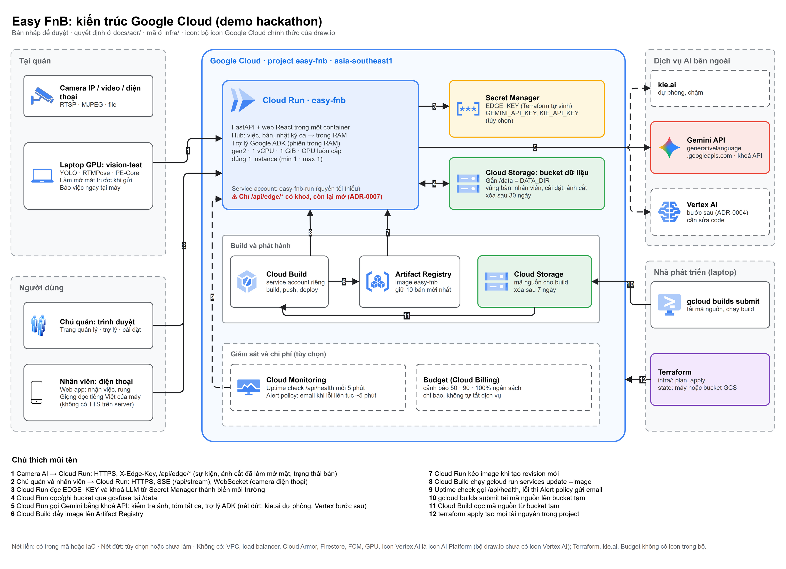
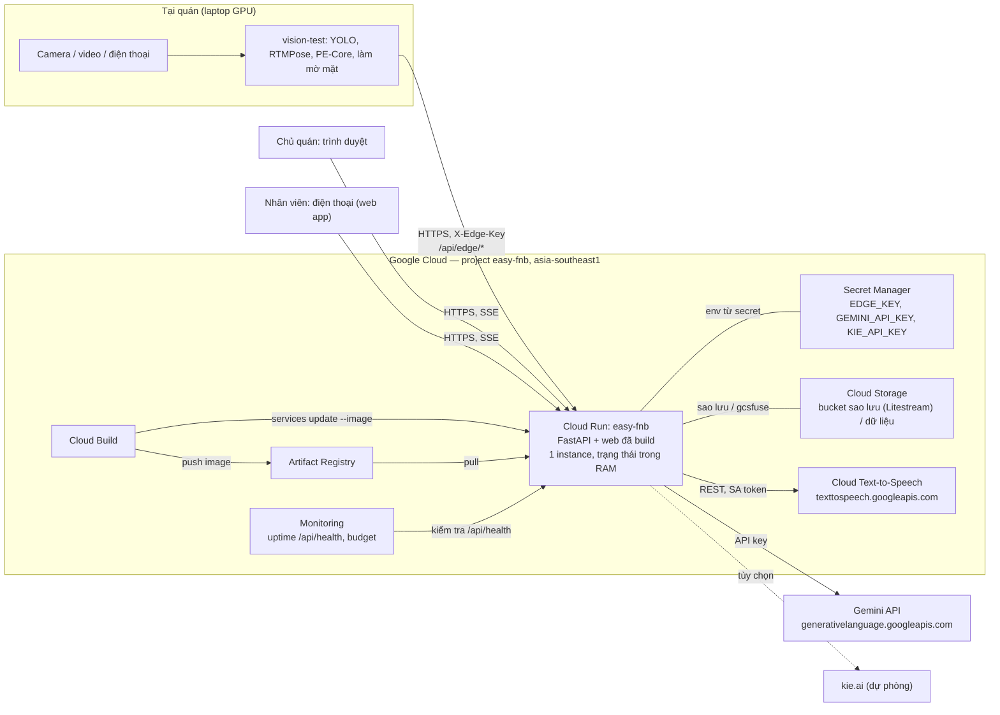

# Thiết kế hạ tầng Google Cloud cho Easy FnB

Phạm vi: **demo hackathon** (một project, một môi trường). Mã nằm ở `infra/`, các quyết định ở `docs/adr/`. Tài liệu này mô tả hệ thống như **mã hiện tại** chạy được, không phải như báo cáo nghiên cứu đề xuất; chỗ hai bên khác nhau nằm ở mục [Khác biệt so với báo cáo](#khác-biệt-so-với-báo-cáo-và-đề-tài-đăng-ký).

Trạng thái: bản nháp để duyệt. Chưa `terraform apply` lên project thật; mới chạy `terraform validate` và `terraform test` (provider giả).

> **Phạm vi.** Tài liệu này chỉ mô tả hạ tầng **demo** (suy luận ở laptop GPU tại quán, chế độ edge). Kiến trúc tổng thể cho nhiều quán, với **suy luận chạy trên cloud** và các phần chịu tải (GPU, hàng khung, Pub/Sub, Firestore, co giãn), nằm ở [`architecture.md`](architecture.md) và ADR-0010 đến ADR-0015. Phần đó chưa có trong IaC.

## 1. Sơ đồ

Sơ đồ sửa được: [`architecture/google-cloud-demo.drawio`](architecture/google-cloud-demo.drawio). Bản văn bản rút gọn:

## 2. Thành phần

| Thành phần | Tài nguyên Terraform | Cấu hình chính | Vì sao |
|---|---|---|---|
| Ứng dụng | `google_cloud_run_v2_service.app` | gen2, 1 vCPU, 2 GiB, `min=1 max=1`, CPU luôn cấp, timeout 3600 s, concurrency 200. Biến môi trường: `EDGE_KEY`, khoá LLM (Secret Manager), `CLIPS_MAX_MB` (mặc định 200), `TTS_ENGINE=google`, `GOOGLE_TTS_VOICE` (mặc định `vi-VN-Chirp3-HD-Aoede`), `BACKUP_BUCKET` (khi bật sao lưu), tùy chọn `GEMINI_MODEL`, `GEMINI_VERIFY_MODEL` | ADR-0001, ADR-0003 |
| Danh tính chạy app | `google_service_account.run` | Chỉ đọc 1–3 secret, quyền `objectAdmin` trên bucket sao lưu (hoặc ghi bucket dữ liệu khi `persist_data`) | Quyền tối thiểu |
| Khoá | `google_secret_manager_secret.*` | `EDGE_KEY` (sinh ngẫu nhiên), `GEMINI_API_KEY`, `KIE_API_KEY` (hai khoá sau tùy chọn) | ADR-0005 |
| Sao lưu | `google_storage_bucket.backup` | **Mặc định bật (`backup_data = true`, tắt khi `persist_data = true`).** Bucket `<project>-<service>-backup`. Litestream đồng bộ `timeline.db`, `quan.db` mỗi 5s; script đồng bộ `config.json`, `staff/`, `chat/` mỗi 10s. Khôi phục khi khởi động lại | ADR-0003 |
| Dữ liệu (gcsfuse) | `google_storage_bucket.data` | **Chỉ khi `persist_data = true` (mặc định tắt).** Gắn `/data` = `DATA_DIR`; xoá sau 30 ngày; chặn truy cập công khai. Tắt thì dùng bucket sao lưu Litestream | ADR-0003 |
| Giọng đọc | `google_project_service.api["texttospeech..."]` | Bật API `texttospeech.googleapis.com`. App gọi REST bằng token từ metadata server, biến `tts_voice` (mặc định `vi-VN-Chirp3-HD-Aoede`). Thay thế Piper | ADR-0008 |
| Image | `google_artifact_registry_repository.app` | Giữ 10 bản mới, xoá bản quá 30 ngày | ADR-0006 |
| Build/deploy | `infra/cloudbuild.yaml` + `google_service_account.build` | Build → push → `gcloud run services update --image` | ADR-0006 |
| Giám sát | `monitoring.tf` | Uptime check `/api/health` mỗi 5 phút, cảnh báo email, budget 50/90/100% | ADR-0009 |
| AI | không có tài nguyên | Gọi Gemini bằng khoá qua mạng ngoài; Vertex là bước sau | ADR-0004 |

Không có: VPC, Cloud NAT, load balancer, Cloud Armor, Cloud SQL, Firestore, Pub/Sub, GPU. Cloud Run ra Internet trực tiếp và nhận tải qua URL `*.run.app`.

## 3. Luồng dữ liệu

1. **Camera → máy chủ.** Pipeline trên laptop gửi sự kiện (`POST /api/edge/event`), ảnh bằng chứng (`/edge/evidence`), khung hình trực tiếp (`/edge/frame`) và trạng thái bàn (`/edge/tables`) kèm header `X-Edge-Key`. Mặt khách được làm mờ **trước khi** ảnh rời máy (`easyfnb_test.py`, hàm `blur_faces`). Camera không dùng GPU trên cloud.
2. **Điều phối.** `Hub` giữ việc, bàn và nhật ký trong RAM, chuyển việc theo bộ đếm (`tick_forever`). Vì vậy CPU phải luôn được cấp (`cpu_idle = false`).
3. **Đẩy xuống người dùng.** Trang quản lý và điện thoại nhân viên nhận sự kiện qua SSE (`/api/stream`); camera điện thoại qua WebSocket (`/api/phone/{cam}/ws`) và MJPEG.
4. **AI.** Kiểm tra ảnh, tóm tắt ca và trợ lý hỏi đáp gọi Gemini (hoặc kie.ai) từ Cloud Run. Việc báo nhân viên **không** chờ AI: camera tự quyết, AI xác nhận hoặc huỷ sau.
5. **Giọng đọc.** Cloud Run dùng Google Cloud Text-to-Speech (`TTS_ENGINE=google`, biến `tts_voice`, mặc định `vi-VN-Chirp3-HD-Aoede`) qua endpoint `/api/tts`; token lấy tự động từ metadata server. Điện thoại cũng có thể đọc bằng giọng tiếng Việt cục bộ (`speechSynthesis`).

## 4. Bảo mật

| Lớp | Hiện trạng | Rủi ro còn lại |
|---|---|---|
| Camera → máy chủ | `X-Edge-Key` từ Secret Manager, chỉ 4 endpoint `/api/edge/*` kiểm tra | Khoá nằm trên máy camera; lộ khoá = gửi được sự kiện giả |
| Người dùng → máy chủ | **Không xác thực.** Cloud Run mở `allUsers`; ngoài `/api/edge/*` không endpoint nào kiểm tra gì | Bất kỳ ai biết URL gọi được `POST /api/reset`, `PUT /api/zones`, `PUT /api/staff`, `POST /api/assistant` (tốn quota Gemini) và đọc ảnh cắt, xem camera trực tiếp. Chi tiết và cách giảm: ADR-0007 |
| Khoá LLM | Secret Manager, gắn vào env của Cloud Run | Khoá nằm trong state Terraform nếu truyền qua `TF_VAR_*` |
| Dữ liệu ảnh | Mặt đã làm mờ ở camera; bucket chặn truy cập công khai, xoá sau 30 ngày | Ảnh vẫn là dữ liệu của quán; báo cáo nhắc Luật 91/2025 về dữ liệu nhạy cảm, **chưa có đánh giá pháp lý** |
| IAM | Hai service account riêng, quyền theo từng tài nguyên | Người chạy Terraform cần quyền Owner/Editor trên project |
| CORS | `allow_origins=['*']` | Nên siết khi có đăng nhập |

## 5. Độ tin cậy và vận hành

| Tình huống | Điều gì xảy ra |
|---|---|
| Instance khởi động lại hoặc deploy | Mất việc đang mở và cảnh báo (RAM). Giữ lại nhờ bucket sao lưu: lịch sử `timeline.db`, sổ thanh toán `quan.db`, cấu hình vùng bàn, nhân viên, cài đặt và ảnh chat. Clip và ảnh bằng chứng không sao lưu; thay đổi tệp trong <10s cuối có thể mất |
| Gemini chậm hoặc lỗi | App chạy tiếp; không có kiểm tra ảnh/trợ lý AI. Không phải điểm chết đơn lẻ |
| Instance chết lúc đang demo | Cloud Run tạo lại sau vài giây; việc và cảnh báo trong RAM mất, nhưng lịch sử và cấu hình được khôi phục từ bucket sao lưu; uptime check gửi email sau ~5–10 phút |
| Hết ngân sách | Chỉ **cảnh báo**, không tự tắt service |
| Cần quay về bản cũ | `gcloud run services update-traffic easy-fnb --to-revisions <revision>=100` hoặc chạy lại build với commit cũ |

Giới hạn: chỉ một instance nên không có dự phòng và không scale ngang. Đây là chủ ý cho demo (ADR-0003).

## 6. Chi phí

Điểm đáng chú ý nhất là `min_instances = 1` + CPU luôn cấp: theo `easy-fnb/HUONG_DAN.md` khoảng **2–3 USD/ngày**, và là khoản gần như duy nhất đáng kể. Sau demo đặt `min_instances = 0` hoặc `terraform destroy`. Các khoản khác (Secret Manager, Artifact Registry, Cloud Storage vài MB, Cloud Build trong hạn mức miễn phí, Monitoring) nhỏ. Gemini tính theo lượt gọi; báo cáo ước tính cỡ $0.0003/lần cho ảnh cắt, **chưa đo trên hệ thống thật**. Các con số chưa được đối chiếu với Pricing Calculator.

## 7. Khác biệt so với báo cáo và đề tài đăng ký

`reports/Easy FnB không mua phần cứng.md` và `DE_TAI_DANG_KY.md` nêu nhiều dịch vụ mà **mã hiện tại không dùng**. Hạ tầng này chỉ cấp phát những gì mã cần.

| Dịch vụ được nêu | Có trong mã? | Có trong IaC? | Ghi chú |
|---|---|---|---|
| Cloud Run | Có | Có | |
| Gemini API | Có (REST, API key) | Qua Secret Manager | Báo cáo khuyên Vertex để dùng credit (ADR-0004) |
| Google ADK | Có (`tro_ly.py`, phiên trong RAM) | — | Chạy trong cùng container |
| Cloud Storage | Bucket sao lưu Litestream + tùy chọn `DATA_DIR` | Có (mặc định tạo bucket backup; `persist_data` tắt) | Sao lưu SQLite (5s) và config/ảnh (10s); clip nằm ở RAM `DATA_DIR/clips`, trần `CLIPS_MAX_MB` |
| Firestore (trạng thái, vector, `onSnapshot`) | Không | Không | ADR-0003 |
| FCM | Không | Không | Đang dùng SSE; chưa có app native |
| Cloud TTS Chirp 3 HD | Có (`server/tts.py`, engine google) | Có (`texttospeech.googleapis.com`, biến `tts_voice`) | Gọi REST với token từ metadata server; mặc định `vi-VN-Chirp3-HD-Aoede` |
| Gemini Embedding / tìm lại video | Không | Không | |

Nếu bài đăng ký cần nói đúng những gì đã làm, nên rà lại mục dịch vụ trong `DE_TAI_DANG_KY.md` với bảng này.

## 8. Chưa làm

- Xác thực chủ quán và nhân viên (ADR-0007), siết CORS.
- Gọi Gemini qua Vertex bằng service account (cần sửa `gemini.py`, `tro_ly.py`) để dùng credit sự kiện.
- Đóng gói VieNeu cho container hoặc giọng đọc offline (Chirp 3 HD trên Cloud Run đã xong).
- Trigger Cloud Build từ GitHub (cần nối kho mã trong Console một lần), nhiều môi trường dev/prod.
- Nhiều quán (đa thuê bao) và lưu trạng thái ngoài RAM.
- Custom domain, Cloud Armor, VPC Service Controls.
