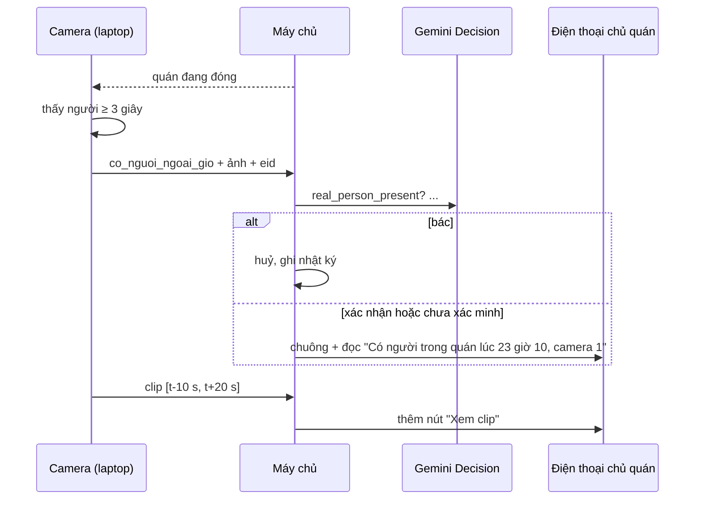

# An ninh và chống trộm cho quán: thiết kế (chưa code)

Ngày: 13/11/2026 · Nhánh: `gemini-decision` · Trạng thái: **chờ duyệt** (bản 2)

Bản 2 đổi so với bản 1: tập trung **trộm cắp đồ** và **an ninh quán** (người lạ, ngoài giờ), bỏ ẩu đả, ngã, đám đông. Thêm cài đặt **che mặt hay không**, và khi che thì **luôn giữ bản không che** để chủ quán xem lại.

## 1. Mục tiêu

Dùng camera và hệ thống đang có để báo cho quán khi:

- có người **lấy đồ không phải của mình**: đồ của khách bàn khác, đồ khách để quên, đồ của quán ở quầy hay kho;
- có người **trong quán ngoài giờ**.

Mỗi cảnh báo kèm clip, qua Gemini Decision kiểm tra trước khi báo, và hỏi lại được bằng trợ lý ("Hôm nay có ai lấy đồ của khách không?").

Không làm: nhận diện mặt, danh sách đen, ẩu đả, ngã, khói lửa.

## 2. Hệ thống đang có, phần dùng lại được

| Có sẵn | Dùng cho chống trộm thế nào |
|---|---|
| `yolo26n-pose` + ByteTrack | Bám từng người; vị trí cổ tay để biết ai chạm vào đồ |
| `yolo26s` (lớp COCO: `handbag`, `backpack`, `suitcase`, `cell phone`, `laptop`), YOLOE | Thấy đồ có giá trị trên bàn, ghế |
| Bộ mã hoá PE-Core (đang dùng cho nhân viên/khách) | Vector **dáng người, quần áo** (không phải mặt) để so "người lấy có phải người ngồi bàn này không" |
| `nhanvien_pe_b16.pt` | Nhân viên hay khách |
| Gemini Decision, câu hỏi xác suất | Xác minh trên ảnh trước khi báo |
| `giai_doan.py`: khách tạm rời còn đồ, giữ bàn `HOLD_S` | Biết bàn nào đang có đồ không người trông |
| `ghi_video.py` ghi liên tục, clip sự kiện, `POST /api/clips` | Clip bằng chứng |
| `timeline.py`, trợ lý ADK, `xem_lai.py` | Nhật ký lưu bền, hỏi đáp kèm video |
| App nhân viên (chuông, rung, đọc to) | Kênh báo |

Chưa có: vùng không phải bàn (quầy, kho, giữ xe), giờ mở/đóng cửa, "đồ này của bàn nào", kênh báo cho chủ quán khi không mở trang quản lý, **đăng nhập** (quan trọng cho video không che mặt, xem mục 6).

## 3. Các tình huống, đánh giá và xếp hạng

Độ chính xác là ước lượng, **chưa đo** trên quán thật. Tài liệu tìm được (mục 10) phần lớn là số của hãng bán hoặc thử trong điều kiện kiểm soát.

| Hạng | Tình huống | Model sẵn có | Độ chính xác thực tế (ước lượng) | Gemini xác minh | Rủi ro báo nhầm | Làm cho demo |
|---|---|---|---|---|---|---|
| **1** | **Người lạ lấy đồ của khách** (túi, điện thoại, laptop trên bàn hoặc ghế; nhất là khi khách tạm rời) | Có: người + đồ + cổ tay + vector dáng người | Trung bình với đồ to để trên bàn; kém với đồ dưới gầm bàn, sau lưng ghế, đồ nhỏ, góc camera bị che | Có, đúng chỗ mạnh của Gemini: "người trong ảnh B có phải người trong ảnh A (theo quần áo) không", "có cầm đồ đi không" | Trung bình: bạn cùng bàn cầm hộ, nhân viên cất đồ để quên, khách đổi chỗ | **Có**, dựng cảnh được |
| **2** | **Có người trong quán ngoài giờ** (trộm đêm) | Có: phát hiện người | Cao khi đủ sáng; tối hẳn hoặc hồng ngoại thì giảm, chưa đo | Có: "người thật hay bóng, tranh" | Thấp: nhân viên ở lại, chủ quán quay lại | **Có**, dễ nhất |
| **3** | **Người không phải nhân viên vào quầy, kho** (lấy tiền, hàng của quán) | Có: người + nhân viên/khách | Trung bình, phụ thuộc model nhân viên/khách | Có: "có mặc đồng phục không", "có cầm gì từ quầy không" | Trung bình: shipper, người nhà chủ quán | **Có** |
| 4 | Đồ khách quên bị người khác lấy | Như hạng 1 (là trường hợp riêng của hạng 1) | Như hạng 1 | Như hạng 1 | Thấp hơn hạng 1 vì biết rõ bàn đang không có chủ | Có, gộp vào hạng 1 |
| 5 | Trộm xe máy ở chỗ giữ xe trước quán | Một phần: `motorcycle` + người; ngoài giờ thì hạng 2 đã bắt được | Trong giờ: thấp, vì phải nhớ ai dựng xe nào, người khác lấy hộ là chuyện thường | Có thể, như hạng 1 | Cao trong giờ | Không. Ngoài giờ: bật hạng 2 cho camera nhìn chỗ giữ xe |
| 6 | Khách bỏ về không trả tiền | Không đủ: cần biết bàn đã trả chưa (máy tính tiền) | Thấp khi không có POS | Không bù được dữ liệu thiếu | Rất cao, và báo nhầm là buộc tội khách | Không |
| 7 | Nhân viên lấy tiền trong két | Không: không có model két, không có POS | Không làm được | — | — | Không |

**Kết luận:** làm **1 (gộp 4), 2, 3**. Hạng 5 chỉ dùng chế độ ngoài giờ. Không làm 6, 7 khi chưa có kết nối máy tính tiền.

## 4. Phần chung

### 4.1 Vùng, giờ, chế độ trông quán

- **Loại vùng mới** khi vẽ đa giác ở Cài đặt: `bàn` (như cũ), `quầy`, `kho/bếp`, `giữ xe`, `cửa`.
- **Giờ mở/đóng cửa** trong Cài đặt (một khung giờ cho mọi ngày).
- **Nút "Trông quán"** ở thanh trên: bật tay là coi như quán đóng. Tự bật theo giờ đóng.

### 4.2 Loại sự kiện mới

| Camera gửi (`kind`) | Máy chủ hiểu là | Khi nào |
|---|---|---|
| `lay_do` | `item_taken` | Đồ có giá trị rời khỏi bàn/ghế trong tay một người **không thuộc bàn đó** (mục 5.1) |
| `co_nguoi_ngoai_gio` | `after_hours` | Quán đang đóng, có người trong khung ≥ 3 giây |
| `vao_khu_cam` | `restricted` | Người được chấm là khách ở trong vùng `quầy` hoặc `kho/bếp` ≥ 3 giây |

Đây là **cảnh báo an ninh**, tách khỏi việc phục vụ: không tính vào số liệu ca hay báo nhầm của nhân viên; không chia theo vai trò `serve`/`clean`; gộp trùng như cũ; ghi `timeline.py` nhóm `an_ninh`; thêm vào `LOAI_CO_CLIP` của `ghi_video.py`. Clip an ninh lấy `[t-10 s, t+20 s]` thay vì `[t-6 s, t+8 s]`.

### 4.3 Xác minh bằng Gemini Decision

Đi đúng đường `_verify_inner`: chờ gói ảnh, hỏi câu xác suất, quyết bằng ngưỡng. An ninh luôn **giữ lại tới khi xác minh xong** (`hold_until_verified`). Lỗi, quá hạn, không chắc thì **vẫn báo**, nhãn "Chưa xác minh". Chỉ bác khi khá chắc là nhầm.

Ảnh gửi Gemini **luôn là bản đã che mặt**, kể cả khi quán tắt che mặt (mục 6): Gemini chỉ cần quần áo và tay, không cần mặt.

| Loại | Ảnh gửi | Câu hỏi | Bác khi | Xác nhận khi |
|---|---|---|---|---|
| `item_taken` | A: người của bàn (ảnh cắt lúc ngồi); B: dải 4 khung lúc lấy, khung đỏ quanh người lấy; C: toàn cảnh | `item_taken` (B cầm đồ rời bàn), `same_person_as_reference` (B và A cùng người, theo quần áo, dáng), `wearing_staff_uniform`, `image_clear` | `same_person_as_reference` ≥ 0,7, hoặc `item_taken` ≤ 0,2 | `item_taken` ≥ 0,7 và `same_person_as_reference` ≤ 0,3 |
| `after_hours` | dải 4 khung, toàn cảnh | `real_person_present`, `wearing_staff_uniform`, `image_clear` | `real_person_present` ≤ 0,2 | `real_person_present` ≥ 0,7 |
| `restricted` | dải 4 khung, toàn cảnh có vùng | `person_in_marked_area`, `wearing_staff_uniform`, `delivery_person`, `took_item` | `wearing_staff_uniform` ≥ 0,7, hoặc `person_in_marked_area` ≤ 0,2 | `person_in_marked_area` ≥ 0,7 |

Với `item_taken`, `wearing_staff_uniform` ≥ 0,7 **không bác** mà đổi lời thành "Nhân viên cất đồ ở bàn 3" và chỉ ghi nhật ký (nhân viên cất đồ để quên là đúng việc).

### 4.4 Báo cho ai

| Loại | Báo cho | Đọc to | Lý do |
|---|---|---|---|
| `item_taken` | Nhân viên phục vụ đang online **và** chủ quán | **Không**. Rung + chữ + ảnh trên máy | Đọc to "có người lấy túi" trước mặt khách vừa ồn vừa có thể buộc tội nhầm. Nhân viên nhìn ảnh rồi tự ra xem |
| `after_hours` | Chủ quán (và người trực đêm nếu có) | Có, chuông riêng | Nhân viên đã về |
| `restricted` | Thu ngân đang online; 30 giây chưa ai bấm "Đã biết" thì chủ quán | Không | Như `item_taken` |

**Chủ quán nhận bằng gì:** thêm vai trò `owner` cho danh sách nhân viên. Chủ quán mở app nhân viên của mình (`/nv/<id>`, đã có mã QR, thêm vào màn hình chính) trên điện thoại; app này nhận cảnh báo an ninh, không nhận việc phục vụ. Giới hạn: trình duyệt phải đang mở. Thông báo khi tắt màn hình (Web Push/FCM) để sau.

### 4.5 Màn hình chủ quán (giữ gọn)

1. **Trang "Bây giờ"**: cảnh báo an ninh hiện trên cùng, thẻ viền đỏ: một dòng chữ, ảnh nhỏ, nút "Xem clip", "Đã biết", "Báo nhầm". Không lẫn vào hàng việc phục vụ.
2. **Thanh trên**: nút "Trông quán".
3. **Cài đặt**: loại vùng; giờ mở/đóng; công tắc từng tính năng; mục **Quyền riêng tư** (mục 6).
4. **Trợ lý**: công cụ đọc nhóm `an_ninh` trong dòng thời gian, trả lời kèm video. Câu mẫu: "Đêm qua có ai vào quán không?", "Hôm nay có ai lấy đồ của khách không?".

## 5. Thiết kế từng tính năng

### 5.1 Người lạ lấy đồ của khách (`item_taken`)

**Ý chính:** mỗi món đồ có giá trị trên bàn được gắn với **những người đã ngồi bàn đó**. Đồ rời bàn trong tay một người khác thì báo.

Ở camera:

1. **Người của bàn.** Người ngồi (dáng ngồi, tâm hông trong vùng bàn) ≥ 20 giây thì thành "người của bàn". Lưu track id và một vector PE-Core của ảnh cắt thân người (đã che mặt), cộng một ảnh cắt để làm ảnh tham chiếu A. Chỉ trong RAM, xoá khi lượt khách của bàn kết thúc.
2. **Đồ của bàn.** Khi bàn có người, chạy `yolo26s` trên **vùng cắt quanh bàn** thường hơn hiện nay (mỗi ~10 khung thay vì 100, chỉ với bàn đang có khách hoặc đang "tạm rời, còn đồ"). Lớp quan tâm: `handbag`, `backpack`, `suitcase`, `cell phone`, `laptop`; YOLOE thêm "ví", "mũ bảo hiểm" nếu chạy kịp. Đồ đứng yên ≥ 10 giây trong vùng bàn thì thành "đồ của bàn".
3. **Đồ biến mất.** Đồ không còn thấy ở vị trí cũ qua 3 lần quét liên tiếp. Tìm người có cổ tay gần đồ nhất trong 3 giây trước đó: đó là "người lấy".
4. **So người.** Người lấy là người của bàn (cùng track id, hoặc vector gần) → bỏ qua. Là nhân viên → ghi nhật ký "nhân viên cất đồ". Còn lại → gửi `lay_do` kèm ảnh A, dải 4 khung lúc lấy, toàn cảnh.
5. **Bàn đang "tạm rời, còn đồ"** (từ `giai_doan.py`): mọi lần lấy đồ của người không thuộc bàn đều gửi, ngưỡng thấp hơn, lời "Có người lấy đồ khách để lại ở bàn 3".

Ở máy chủ: giữ lại, hỏi Gemini (4.3), rồi báo (4.4). Thẻ cảnh báo có hai ảnh cạnh nhau, "người ngồi bàn" và "người cầm đi", cùng clip `[t-10 s, t+20 s]`.

**Rủi ro biết trước, ghi để đo:** túi treo sau ghế hoặc dưới gầm bàn thường không thấy; người cùng nhóm mới tới chưa ngồi đủ 20 giây sẽ bị coi là người lạ (Gemini so quần áo cũng không cứu được, vì thật sự là người khác: chấp nhận báo, nhân viên nhìn ảnh là biết); chạy `yolo26s` thường hơn tốn GPU trên RTX 3050, phải đo tốc độ.

### 5.2 Có người ngoài giờ (`after_hours`)

- Có vùng `cửa` thì ưu tiên lời "có người vào từ cửa". Camera nhìn chỗ giữ xe dùng chung tính năng này (hạng 5).
- Gộp: cùng camera trong 5 phút thì không chuông lại. Tắt khi bấm "Đã biết" hoặc tắt "Trông quán".

### 5.3 Người không phải nhân viên vào quầy, kho (`restricted`)

- Camera: tâm chân trong vùng `quầy` hoặc `kho/bếp` ≥ 3 giây, chấm là khách. Nhân viên đã nhận theo ảnh (nếu bật) thì bỏ qua.
- Cài đặt có khung giờ giao hàng (ví dụ 7:00-9:00) không báo, để không phải nhận diện shipper.
- Báo theo 4.4, clip có.

## 6. Che mặt: tuỳ chọn, và luôn có bản gốc

### 6.1 Cài đặt

Cài đặt, mục **Quyền riêng tư**, một công tắc: **"Che mặt trong video và ảnh"**, mặc định **bật**.

| | Che mặt **bật** (mặc định) | Che mặt **tắt** |
|---|---|---|
| Ảnh, clip trên app nhân viên, trang quản lý, trợ lý | Đã che | Không che |
| Ảnh gửi Gemini | Đã che | **Vẫn che** (mục 4.3) |
| Bản gốc không che | **Luôn giữ** ở máy quán, chủ quán xem bằng nút "Xem bản gốc" | Là bản đang xem |

### 6.2 Cách giữ bản gốc mà không tốn gấp đôi

Hiện `ghi_video.py` che mặt **trước** khi nén, nên không còn bản gốc. Đổi thành:

- **Ghi bản gốc** (không che) như hiện nay: đoạn 10 giây, giữ 24 giờ hoặc 5 GB, **chỉ ở máy quán**.
- **Ghi kèm tệp vị trí mặt** cho mỗi đoạn (`r..._k.mat.jsonl`: thời điểm khung, các ô mặt lấy từ khung xương pose đã có). Rất nhẹ so với video.
- **Khi cắt clip để gửi đi** (clip sự kiện, `POST /api/clips`): nếu đang che mặt thì giải mã đoạn gốc, che theo tệp vị trí mặt, nén lại. Clip 30 giây ở 960 px nén lại mất khoảng 1-3 giây CPU (cần đo). Nếu thiếu dữ liệu mặt ở khung nào thì **che cả vùng người** ở khung đó, không bao giờ gửi đi khung chưa che.
- Ảnh cắt và gói ảnh xác minh vẫn che ngay ở camera như hiện nay.

Cách này chỉ nén một luồng video. Phương án ghi hai luồng song song (một che, một không) đơn giản hơn nhưng tốn gấp đôi CPU và ổ đĩa trên laptop đang chạy AI, không đề xuất.

### 6.3 Xem bản gốc

- Nút **"Xem bản gốc"** chỉ hiện trên trang chủ quán và app của vai trò `owner`, không hiện ở app nhân viên.
- Bấm thì máy chủ xếp việc `clip` cho máy camera với `goc: true`; camera cắt từ bản gốc, không che. Clip gốc trên máy chủ **tự xoá sau 24 giờ**, không gửi Gemini, không đưa vào trợ lý.
- **Mỗi lần xem ghi vào dòng thời gian**: ai, lúc nào, clip nào.
- Chủ quán có thể bấm **"Giữ làm bằng chứng"** để giữ một clip gốc quá 24 giờ (ví dụ đưa công an); clip được giữ thì không bị dọn theo dung lượng.

### 6.4 Điều kiện bắt buộc: phải có khoá

Hiện ngoài `/api/edge/*` **không có đăng nhập**: ai biết địa chỉ đều gọi được mọi API (`docs/he-thong-hien-tai.md`, mục 10). Mở video không che mặt khi chưa có khoá là để lộ mặt khách cho bất kỳ ai trong wifi, hoặc cả internet nếu chạy trên Cloud Run.

Vì vậy **"Xem bản gốc" và công tắc tắt che mặt chỉ hoạt động khi đã đặt mã PIN chủ quán** (Cài đặt). Máy chủ kiểm mã PIN trên các đường: đổi công tắc, lấy clip gốc, giữ bằng chứng. Chưa đặt PIN thì nút ẩn và luôn che. Đây là khoá tối thiểu, không thay cho đăng nhập đầy đủ.

## 7. Luật và quyền riêng tư

Nghị định 13/2023/NĐ-CP **đã hết hiệu lực** từ 1/1/2026. Hiện áp dụng **Luật Bảo vệ dữ liệu cá nhân 91/2025/QH15** và **Nghị định 356/2025/NĐ-CP**. Phần dưới là đọc từ tóm tắt và bài báo, **chưa qua luật sư**.

| Điểm | Theo nguồn tìm được | Hệ thống xử lý |
|---|---|---|
| Ghi hình nơi công cộng | Điều 32 khoản 1: được ghi và xử lý không cần đồng ý để giữ trật tự hoặc bảo vệ lợi ích hợp pháp. Chưa đọc được các khoản về thông báo, thời hạn lưu | Mục đích ghi rõ: chống trộm, an ninh. Đề xuất biển "Khu vực có camera AI" |
| Ảnh mặt rõ, sinh trắc học | Sinh trắc học là dữ liệu nhạy cảm | Không nhận diện mặt. Bản gốc không che chỉ ở máy quán, có PIN, có nhật ký xem, tự xoá. Tắt che mặt là **quyết định và trách nhiệm của chủ quán**; Cài đặt ghi một câu nhắc điều đó |
| Gửi ra nước ngoài | Chuyển dữ liệu cá nhân ra nước ngoài phải lập hồ sơ đánh giá tác động; vi phạm phạt tới 5% doanh thu năm trước | Gemini luôn nhận bản che. Clip gốc không lên cloud, trừ khi máy chủ chạy trên Cloud Run và chủ quán bấm xem: cần hỏi luật sư cho trường hợp này |
| Vector dáng người | Không phải mặt, nhưng vẫn là dữ liệu về một người | Chỉ trong RAM camera, xoá khi bàn hết lượt khách, không gửi đi |
| Giám sát nhân viên | Dữ liệu camera phải dùng đúng mục đích đã thông báo | Cảnh báo an ninh không chấm điểm nhân viên. Không làm "nhân viên lấy tiền két" |

## 8. Cách đo

Clip tự quay, có nhãn tay, kết quả ghi vào `vision-test/KET_QUA.md`.

| Tính năng | Bộ thử | Số đo | Mục tiêu cho demo |
|---|---|---|---|
| Lấy đồ | 10 lần người lạ lấy túi/điện thoại trên bàn (bàn có khách và bàn tạm rời); 10 lần chính khách cầm đồ của mình; 5 lần nhân viên cất đồ; 5 lần bạn cùng bàn cầm hộ | Bắt được / 10; báo nhầm / 20; tách theo đồ to, đồ nhỏ, đồ bị che; trước và sau Gemini | Đồ to trên bàn ≥ 7/10; báo nhầm sau Gemini ≤ 2/20 |
| Ngoài giờ | 10 lần đi vào (đèn sáng, đèn mờ); 1 giờ quay quán trống ban đêm | Bắt được; báo nhầm/giờ; giây tới lúc chuông | ≥ 9/10; 0/giờ; ≤ 6 giây |
| Quầy, kho | 10 lần khách vào; 10 lần nhân viên đồng phục; 5 lần shipper | Bắt được; báo nhầm | ≥ 8/10; ≤ 1/10 |
| Che mặt | 20 clip cắt từ bản gốc | Số khung còn lộ mặt khi che bật; thời gian cắt clip | 0 khung lộ mặt; ≤ 3 giây |
| Tốc độ camera | Chạy `yolo26s` trên vùng bàn mỗi 10 khung | FPS trước và sau trên RTX 3050 | Giảm không quá 15% |

Đo thêm: Gemini **bác nhầm** cảnh báo thật bao nhiêu lần (mục tiêu 0).

Test tự động (máy chủ, không mạng): luật quyết định 3 loại mới; an ninh không vào số liệu ca; giao đúng người; PIN chặn clip gốc và công tắc; mỗi lần xem bản gốc có một dòng nhật ký; clip gốc hết 24 giờ thì xoá, trừ clip giữ làm bằng chứng. Test camera: cắt clip có che từ tệp vị trí mặt; khung thiếu dữ liệu mặt thì che cả người.

## 9. Kịch bản demo (khoảng 1 phút)

1. Khách A ngồi bàn 3, đặt túi lên bàn, đứng dậy đi vệ sinh. Người B đi ngang cầm túi đi → máy nhân viên và chủ quán rung, thẻ có hai ảnh "người ngồi bàn" / "người cầm đi" và clip. Lần thử lại: chính A quay lại cầm túi → không báo.
2. Một người không mặc đồng phục vào sau quầy → máy thu ngân rung.
3. Bật "Trông quán", một người đi vào → điện thoại chủ quán chuông, đọc to.
4. Trên clip đã che mặt, chủ quán nhập PIN, bấm "Xem bản gốc" → thấy mặt; dòng thời gian ghi lại lần xem.
5. Hỏi trợ lý: "Hôm nay có chuyện gì về an ninh không?" → trả lời kèm video.

## 10. Ngoài phạm vi đợt này

- Ẩu đả, ngã, đám đông, khói lửa.
- Khách bỏ về không trả tiền, nhân viên lấy tiền két: cần kết nối máy tính tiền.
- Trộm xe trong giờ mở cửa.
- Nhận diện mặt, danh sách đen.
- Đăng nhập đầy đủ (chỉ làm PIN chủ quán ở mục 6.4).
- Thông báo khi tắt màn hình, gọi điện, SMS.
- Bám một người qua nhiều camera.
- Tư vấn pháp lý.

## 11. Nguồn đã tra

Không tìm được số đo độc lập ngoài thực tế cho "lấy đồ" trong nhà hàng; số của các hãng là tự công bố.

- Camera AI chống thất thoát cho nhà hàng (hãng bán): [Panoptyc](https://panoptyc.com/solutions-dining/), [Solink](https://solink.com/resources/most-important-restaurant-analytics-quick-service-industry), [Savi](https://getsavi.com/blog/camera-ai-restaurant-operators), [Berry AI](https://www.berry-ai.com/products-securitycamera), [QSR Magazine](https://www.qsrmagazine.com/outside-insights/can-ai-help-restaurants-prevent-theft)
- Đồ bỏ quên và gắn đồ với chủ: [Sensors 2025](https://www.ncbi.nlm.nih.gov/pmc/articles/PMC12074375/) (theo dõi theo thời gian và khoảng cách để biết đồ của ai; đồ nhỏ kém hơn đồ vừa; đo trong điều kiện kiểm soát)
- Luật: [Điều 32 Luật BVDLCN 2025](https://hethongphapluat.com/luat-bao-ve-du-lieu-ca-nhan-2025/khoan-1-dieu-32), [Nghị định 356/2025/NĐ-CP](https://thuvienphapluat.vn/van-ban/Quyen-dan-su/Nghi-dinh-356-2025-ND-CP-huong-dan-Luat-Bao-ve-du-lieu-ca-nhan-687428.aspx), [Tilleke & Gibbins](https://www.tilleke.com/insights/vietnam-issues-personal-data-protection-law/6/), [GV Lawyers](https://gvlawyers.com.vn/wp-content/uploads/2025/09/EN_Legal-alert-_Law-on-PDP-2025.pdf), [Hà Tĩnh: luật có hiệu lực 1/1/2026](https://hatinh.gov.vn/vi/bai-viet/luat-bao-ve-du-lieu-ca-nhan-chinh-thuc-co-hieu-luc-thi-hanh-tu-ngay-112026)

## 12. Cần chủ quán quyết trước khi code

1. Thứ tự làm: lấy đồ của khách → quầy/kho → ngoài giờ?
2. Chủ quán nhận cảnh báo bằng app với vai trò `owner` (phải mở trình duyệt) có được cho demo không?
3. Đồng ý điều kiện "phải đặt PIN mới xem được bản gốc / tắt che mặt"?
